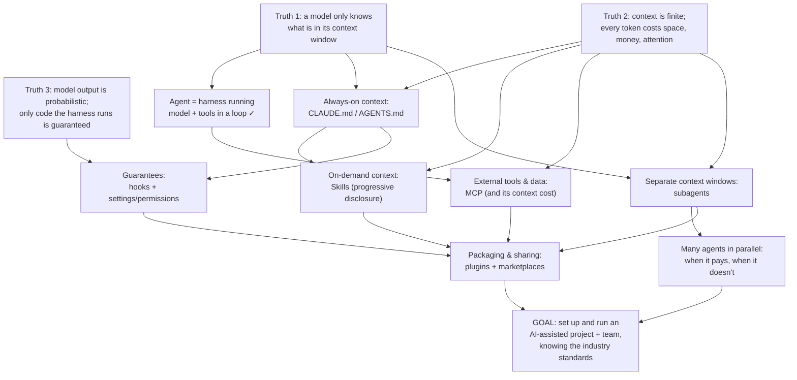
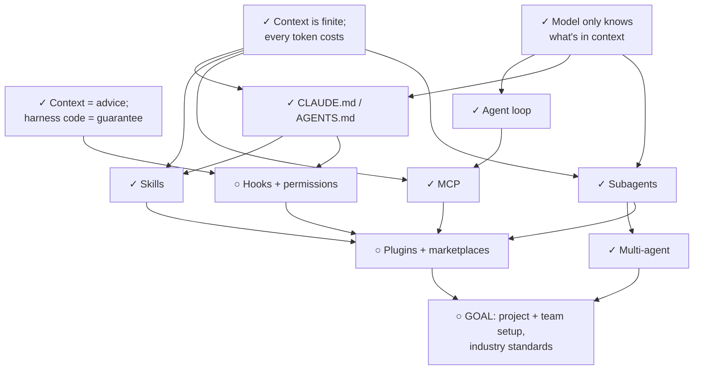
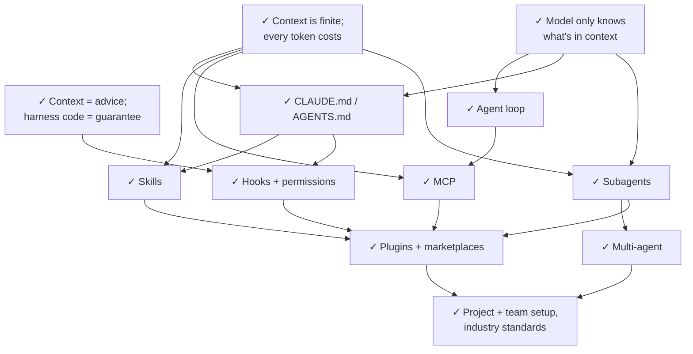

# I want to learn more about AI skills, more speciffically about what agents are, how do you deploy mu

*2026-10-03*

---

### You

/teach I want to learn more about AI skills, more speciffically about what agents are, how do you deploy multiple agents, what are skills, plugins and MCPs and how do you use them in an efficient way, how to set up and work in projects that are AI assisted, md files, what are the industry standards etc

---

### Claude

> [!question] Quiz 1/4
> What most fundamentally makes an AI system an "agent" rather than a plain chatbot?
>
> 1. Special agent fine-tuning — The model has been trained with extra agent-specific data.
> 2. Loop with tool calls — The model runs in a loop, calling tools and reacting to their results until the task is done.
> 3. Long-term memory — The model remembers past conversations across sessions.
> 4. I don't know

> [!question] Quiz 2/4
> What is MCP (Model Context Protocol)?
>
> 1. Claude-only prompt bundle — A Claude-specific file format for packaging reusable prompts.
> 2. Fine-tuning technique — A method for training models to use tools better.
> 3. Open tool/data protocol — An open standard for connecting AI apps to external tools and data through servers.
> 4. I don't know

> [!question] Quiz 3/4
> In Claude Code, what is a "skill"?
>
> 1. Instructions loaded on demand — A folder with a SKILL.md of instructions that the model pulls in only when relevant.
> 2. Server exposing tools — A running process that gives the model new callable functions.
> 3. Weight adapter — A small trained add-on to the model that gives it a new ability.
> 4. I don't know

> [!question] Quiz 4/4
> When a main agent spawns a subagent, what does the subagent start with?
>
> 1. Full conversation copy — Everything the main agent has seen so far.
> 2. Only its task prompt — A fresh context containing just the prompt it was given (plus its own system setup).
> 3. Shared live memory — A context it shares with the parent, so both see each other's updates.
> 4. I don't know

Big topic, and it fits together well. Most of it comes down to a few core ideas. First I'll find where your current knowledge ends so I don't re-teach what you already know. Here are four quick questions. "I don't know" is a useful answer, so pick it whenever it's true.

---

### You

**Your answer:** Loop with tool calls
**Your answer:** Open tool/data protocol
**Your answer:** Instructions loaded on demand
**Your answer:** I don't know

---

### Claude

> [!question] Quiz 5
> Before a skill is ever invoked in a session, how much of it is in the model's context?
>
> 1. The full SKILL.md text — All of its instructions are loaded at session start.
> 2. Nothing at all — The model has no idea it exists until you type /skill-name.
> 3. Just name + description — A one-line summary, with the body loaded only on use.
> 4. I don't know

> [!question] Quiz 6
> What is a Claude Code plugin?
>
> 1. A bundle of extensions — A distributable package that can contain skills, subagents, hooks, commands and MCP server configs.
> 2. A renamed MCP server — The newer name for an MCP server installed from a marketplace.
> 3. A published single skill — One skill that has been shared to a marketplace.
> 4. I don't know

> [!question] Quiz 7
> Which file is the cross-vendor convention for giving coding agents (Codex, Cursor, Copilot, etc.) project instructions?
>
> 1. llms.txt
> 2. .cursorrules
> 3. AGENTS.md
> 4. I don't know

> [!question] Goal
> What do you mainly want to be able to DO after this? *(pick all that apply)*
>
> 1. Work faster in my projects — Use Claude Code (or similar) day-to-day on my own code: setup, CLAUDE.md, skills, subagents, MCPs.
> 2. Build agent products — Write my own agents/multi-agent systems in code (API, Agent SDK, MCP servers).
> 3. Understand the landscape — Know the concepts, vocabulary and industry standards well enough to evaluate tools and talk about them.
> 4. Set up team workflows — Standardise AI-assisted dev for a team: shared configs, plugins, conventions.

---

### You

**Your answer:** I don't know
**Your answer:** A bundle of extensions
**Your answer:** AGENTS.md
**Your answer:** Work faster in my projects, Understand the landscape, Set up team workflows

---

### Claude

> [!question] Plan
> Start with this plan?
>
> 1. Start with this plan — Begin with the three root truths and work down the map.
> 2. Change something — Adjust scope, order, depth, or add/remove a topic (e.g. building agents in code).

The research is back. One thing changed since older tutorials: Claude Code now reads AGENTS.md natively, but only as a fallback. I'll teach the current version.

## The plan

**Approach.** Every piece you asked about (CLAUDE.md, skills, MCP, subagents, plugins, hooks) answers the same two questions: *what goes into the model's context, and when?* and *what must be guaranteed rather than just suggested?* So we start from three facts about the model itself. Then we "discover" each mechanism as the fix for a specific problem those facts create. Once you can see the problem each one solves, choosing between them stops being guesswork. We finish with how to put this together in a real project and a team, and which parts are now industry standards.



The node marked ✓ (the agent loop) you already have, so I'll only check it briefly. Most of the time will go to the middle layer, which is where your edge is. I'll use a mix of styles: you're likely to work out the reasons yourself at several points (e.g. *why* skills load lazily), so those parts will be questions. The facts about specific mechanisms will be explained directly.

---

### You

**Your answer:** Start with this plan

---

### Claude

> [!question] Quiz
> Yesterday you told Claude "we use pnpm, not npm" in chat. Today you open a fresh session (no CLAUDE.md, no memory files) and it runs `npm install`. What is the actual reason?
>
> 1. Its memory decayed overnight
> 2. It saw it but chose npm
> 3. It was never in today's context
> 4. I don't know

---

### You

**Your answer:** It was never in today's context

---

### Claude

> [!question] Quiz
> Given Truths 1 and 2, what is the ideal content of the context window at any moment?
>
> 1. Smallest set needed now
> 2. Everything possibly relevant
> 3. As little as possible overall
> 4. I don't know

---

### You

**Your answer:** Smallest set needed now

---

### Claude

> [!question] Quiz
> You must be 100% sure Claude never edits your .env file. Which of these actually guarantees it?
>
> 1. A capitalised NEVER rule in CLAUDE.md
> 2. Repeating the rule in every prompt
> 3. A harness rule rejecting that edit
> 4. I don't know

---

### You

**Your answer:** A capitalised NEVER rule in CLAUDE.md

---

### Claude

> [!question] Quiz
> Where in the pipeline does a rule written in CLAUDE.md have its effect?
>
> 1. After the model, filtering tool calls
> 2. Before the model, as text it reads
> 3. Inside the model, adjusting its weights
> 4. I don't know

---

### You

**Your answer:** I don't know

---

### Claude

> [!question] Quiz
> In the employee analogy, which one is a settings deny rule?
>
> 1. The employee's education
> 2. The morning handbook
> 3. The lock on the door
> 4. I don't know

---

### You

**Your answer:** The lock on the door

---

### Claude

> [!question] Quiz
> Which of these lines best deserves a place in a project's CLAUDE.md?
>
> 1. "Write clean, readable, well-tested code."
> 2. "Run tests with pnpm test:unit, not pnpm test."
> 3. The full 40-step release procedure
> 4. I don't know

✓ Correct. The lock is the deny rule, the handbook is CLAUDE.md, education is the weights. That distinction is now in place, and it will produce hooks and permissions later.

All three roots are in place:
1. The model only knows what's in context.
2. Context is finite and every token costs something.
3. Context is advice; only harness code guarantees.

Now we work down the map. The agent loop (harness → model → tool request → harness runs it → result back into context) you already had, and you've just seen it from the inside. So, on to the first mechanism.

## Node 4: Always-on context, CLAUDE.md and AGENTS.md

**Motivation.** Remember the pnpm problem from Node 1: some facts are needed in **every** session, but each new session starts empty. Typing them again each time is tedious and you'll forget. The obvious fix is to have the *harness* read a file from disk at session start and put it into context automatically.

That's all **CLAUDE.md** is: a Markdown file that Claude Code reads and loads into context at the start of every session. It's the handbook from the analogy. No magic, no enforcement (Node 3).

**Where it can live** (all applicable files are loaded together, not one replacing another):

| File | Scope | Shared? |
|---|---|---|
| `~/.claude/CLAUDE.md` | You, in every project | No |
| `./CLAUDE.md` (or `./.claude/CLAUDE.md`) | This project | Yes, committed to git |
| `./CLAUDE.local.md` | You, in this project | No, gitignored |
| `subfolder/CLAUDE.md` | That part of the repo | Yes, loaded **only when Claude reads files there** |

That last row is Node 2 in action again: guidance for one folder only enters context when work actually reaches that folder.

**AGENTS.md** is the same idea, standardised across vendors. Every tool used to have its own file (`.cursorrules`, `CLAUDE.md`, …). AGENTS.md is a plain-Markdown convention read by 25+ tools (Codex, Cursor, Copilot, …). Since December 2025 it's stewarded by the Linux Foundation's **Agentic AI Foundation**, alongside MCP. One Claude Code detail: it reads AGENTS.md **only as a fallback** when no CLAUDE.md exists. If a team uses several tools, the usual pattern is to keep the shared instructions in `AGENTS.md` and have `CLAUDE.md` import it with the line `@AGENTS.md`.

**Now derive the rule yourself.** This file is loaded into **every** session and re-read on **every** call of the loop (Truth 2). Which line deserves a place in it?

---

### You

**Your answer:** "Run tests with pnpm test:unit, not pnpm test."

---

### Claude

> [!question] Quiz
> Your project has a well-written `release` skill, but when you say "ship v2.3" Claude never uses it and improvises instead. What's the most likely right fix?
>
> 1. Rewrite the skill's description
> 2. Move the skill body into CLAUDE.md
> 3. Make the SKILL.md body more detailed
> 4. I don't know

✓ Correct. The other two fail for different reasons, and each reason matters:

- **"Write clean, readable code"** is something the model already does from its training (its weights). The line costs tokens in every call and changes nothing. Anthropic's test for every line: *"Would removing this cause Claude to make mistakes?"* If not, cut it.
- **The 40-step release procedure** is useful, but you release maybe once a month. Loading it into *every* session means paying for it in context hundreds of times to use it once.

So a good CLAUDE.md holds **non-obvious, frequently needed facts**: build and test commands, traps ("`pnpm test` hits the prod DB"), the repo layout, conventions the model wouldn't guess. Anthropic's guidance is to keep each file **under ~200 lines**, because longer files are followed less reliably (context rot again). One trap to know about: `@imports` help *organise* the file, but they load at session start too, so they **don't save any tokens**. The `/init` command generates a starter CLAUDE.md from your repo, which you then cut down.

That leaves a problem: where *does* the release procedure go?

## Node 5: On-demand context, Skills

**Motivation.** We need knowledge that's *available* to the model but costs (almost) nothing until the moment it's needed. Truth 1 says the model must know the procedure *exists*, or it can't ask for it. Truth 2 says the full text shouldn't sit in context.

The fix is the one you saw in the probe, and now you can see *why* it's built that way. It's called **progressive disclosure**, in three tiers:

| Tier | What's in context | When |
|---|---|---|
| 1 | `name` + `description` from the frontmatter (~100 tokens) | Always, from session start |
| 2 | The full `SKILL.md` body (keep it under ~500 lines) | When the skill is used |
| 3 | Bundled files (`scripts/`, `references/`, templates) | Only when the body says to open them |

A skill is just a folder:

```
.claude/skills/release/
├── SKILL.md          ← frontmatter (name, description) + instructions
├── scripts/bump.sh   ← run by the agent, so its code never needs to enter context
└── references/changelog-format.md
```

A skill gets used in one of two ways. Either **you** type `/release`, or **the model** decides on its own that the task matches the description. You're using one right now: this lesson is driven by `.claude/skills/teach/SKILL.md` in this folder. Skills are also an **open standard** now (agentskills.io), read by Codex, Copilot, Cursor, Gemini CLI and others. That makes a skill folder portable between tools in a way a CLAUDE.md isn't.

Look at tier 1 again. When the model decides on its own, the only thing it has to go on is the description.

---

### You

**Your answer:** Rewrite the skill's description

---

### Claude

> [!question] Quiz
> You want Claude to (a) run queries against your Postgres database and (b) follow your team's conventions for writing migrations. Which mechanism fits which?
>
> 1. Skill for (a), MCP server for (b)
> 2. One MCP server for both
> 3. MCP server for (a), skill for (b)
> 4. I don't know

✓ Correct. The model's decision to use a skill is based **only** on tier 1, the description, so a skill with a vague description is effectively invisible. A good description says *what it does and when to use it*, including the words people actually say: "Use when releasing, shipping, tagging or publishing a new version." Moving the body into CLAUDE.md would make it work, but you'd be paying for it in every session again (the problem we just solved). A more detailed body doesn't help, because the body is never read if the description doesn't match.

## Node 6: External tools and data, MCP

**Motivation.** So far the agent's tools are built in: read file, edit file, run a shell command. But real work involves other systems: a database, Jira, Figma, GitHub, the Unity editor. Before 2024, *every* AI app had to write its own integration for *every* service. With N apps and M services, that's $N \times M$ integrations, mostly duplicated effort.

**The fix is a standard plug.** The **Model Context Protocol** defines one way for an AI app to discover and call external tools. Each service writes one **MCP server**, and every MCP-capable app can use it: $N + M$ instead of $N \times M$. It's the same reasoning that gave us USB.

- **Host**: the AI app (Claude Code, Cursor, VS Code…). It starts one **client** connection per server.
- **Server**: a small program exposing **tools** (functions the model can call), **resources** (data it can read) and **prompts** (templates).
- **Transport**: either a local process on your machine (**stdio**) or a remote service over **HTTP**.
- In Claude Code you add servers with `claude mcp add`. A project-scoped `.mcp.json` gets committed so the whole team gets the same servers.

**Now apply Truth 2.** For the model to *call* a tool, its name, description and parameter schema have to be in context. Anthropic measured one setup where 58 tools took about **55,000 tokens before you'd typed anything**. The mitigation should look familiar: **tool search / deferred loading**. Only tool *names* sit in context, and the full definition is fetched when needed. That's progressive disclosure again, now for tools. Claude Code does this by default. You can see it in this very session: your Unity editor MCP server exposes around 180 tools, and right now I hold only their names.

A related practical rule: if a well-known CLI exists (`gh`, `aws`, `psql`), it's often cheaper than an MCP server. The model already knows the CLI from training (the weights), so no schema costs any context.

**Skills vs MCP, the distinction people blur:** MCP gives the agent new **abilities** (it *can* talk to Jira). A skill gives it **know-how** (*how your team* does a release). They often work together.

---

### You

**Your answer:** MCP server for (a), skill for (b)

---

### Claude

> [!question] Quiz
> In chat, you and Claude spend 20 minutes deciding to use Zod (not Yup) for validation. Nothing is written to any file. Claude then spawns a subagent with the prompt "Add validation to the signup form." What happens?
>
> 1. It uses Zod, as discussed
> 2. It may pick either library
> 3. It pauses to ask the parent which
> 4. I don't know

✓ Correct. The database is a **capability** the agent lacks, so it needs a connection: MCP. Migration conventions are **know-how** it lacks, so they need instructions loaded on demand: a skill. One MCP server *could* hand out prompt templates, but conventions that live in your repo, are reviewed in git and shared through skills are the normal choice.

## Node 7: Separate context windows, subagents

This is where your probe hit a gap (Quiz 4), so we'll take it slowly.

**Motivation.** You ask: *"Where is authentication handled in this repo?"* To answer, the agent reads 40 files, maybe 80,000 tokens of code, all appended to **your** context (Node 1). You needed a 10-line answer. The other 79,000 tokens now sit there for the rest of the session, costing money and attention on every call (Node 2).

How could you get the *conclusion* without keeping the *mess*? You know a model call only sees what's in its window. So **start a second agent loop with its own empty window.** Give it the task, let it read all 40 files in *its* window, and take back only its final answer. Its window is then thrown away.

That's a **subagent**. Following directly from Truth 1, a subagent's window contains:

| ✓ Gets | ✗ Doesn't get |
|---|---|
| Its own system prompt (its definition) | Your conversation with the parent |
| **The task prompt the parent wrote** | Files the parent already read |
| CLAUDE.md, project setup | Decisions you made in chat |

And on the way back, **only its final report** reaches the parent.

You just watched this happen. When I planned this lesson, I sent a `researcher` subagent off with a self-contained prompt. It made 26 tool calls and used about 125,000 tokens of web pages in *its* window. My context received only the ~3-page report.

Subagents are defined as Markdown files in `.claude/agents/<name>.md`. The frontmatter holds a `name`, a `description` (which works like a skill's: it's how the parent decides when to use it), allowed `tools` and `model`, and the body is its system prompt. Built-in ones include **Explore** (read-only searching) and **Plan**.

A useful side effect: a fresh window is a *feature* for **review**. A reviewer subagent sees only the diff, not the parent's reasoning, so it isn't biased by "I already convinced myself this is right."

---

### You

**Your answer:** It uses Zod, as discussed

---

### Claude

> [!question] Quiz
> How do you make sure the subagent uses Zod?
>
> 1. Put "use Zod" in its prompt or a file
> 2. Tell it to check the chat history first
> 3. Nothing; it inherits chat decisions
> 4. I don't know

---

### You

**Your answer:** Put "use Zod" in its prompt or a file

---

### Claude

> [!question] Quiz
> Which task is the best fit for spreading across several parallel agents?
>
> 1. Debugging one intermittent race condition
> 2. Auditing 12 separate services' dependencies
> 3. Refactoring a tightly coupled core module
> 4. I don't know

---

### You

**Your answer:** I don't know

---

### Claude

> [!question] Quiz
> Using the independence test: which of these should be split across parallel subagents?
>
> 1. Designing one new database schema
> 2. Writing a feature then its tests on it
> 3. Summarising 30 unrelated research papers
> 4. I don't know

---

### You

**Your answer:** Summarising 30 unrelated research papers

---

### Claude

> [!question] Pacing
> We've covered 8 of 11 nodes. How do you want to continue?
>
> 1. Keep going — Finish hooks, plugins and the project/team setup now.
> 2. Break here — Stop with a recap; resume next time from the notes.

---

### You

**Your answer:** Break here

---

### Claude

We'll stop here. Here's where you are:



**Solid now:**
- **The core idea.** Every mechanism answers *what's in the context, and when?* The ideal is the smallest set of tokens needed *right now*.
- **CLAUDE.md / AGENTS.md** are always loaded, so they hold only non-obvious, frequently needed facts, under ~200 lines. `@imports` don't save tokens. AGENTS.md is the cross-vendor standard, and Claude Code uses it only as a fallback.
- **Skills** use progressive disclosure: only the description is always in context, and the description decides whether the skill is used.
- **MCP** is a standard plug that gives the agent new *abilities*, while skills give *know-how*. Tool definitions cost context, which tool search fixes the same lazy way.

**Took a second pass. Worth a quick re-check next time:**
- **Advice vs guarantee:** CLAUDE.md is the handbook, a deny rule is the lock. You got it with the employee analogy.
- **Subagents start empty:** same weights, different window. The only bridge is the prompt string (missed twice, then fixed).
- **The independence test for multi-agent:** can each piece be done without hearing what the others found? It costs about 15× the tokens.

**Next session:** we start with a short quiz on those three, then **hooks and permissions** (which turn Truth 3 into practice), then **plugins**, then the payoff: setting up a real AI-assisted project and a shared team configuration step by step, plus where the industry standards (AAIF, AGENTS.md, Agent Skills, MCP) fit.

This session is saved to `notes/` automatically. To pick up again, just say **"continue AI agents"**.

---

### You

continue AI agents

---

### Claude

> [!question] Quiz 1/3
> Which of these is enforced no matter what the model decides?
>
> 1. A deny rule in settings.json
> 2. A rule in the project CLAUDE.md
> 3. An instruction in a skill's body
> 4. I don't know

> [!question] Quiz 2/3
> Earlier in the session the main agent read config.ts. It then spawns a subagent: "Fix the port parsing bug in config.ts." At the moment it starts, what does the subagent have of config.ts?
>
> 1. The parent's copy of its contents
> 2. Nothing until it reads the file
> 3. An automatic summary of the file
> 4. I don't know

> [!question] Quiz 3/3
> Which task is the POOREST fit for splitting across parallel agents?
>
> 1. Translating 20 separate docs pages
> 2. Checking 15 repos for license files
> 3. Reworking one app's whole login flow
> 4. I don't know

---

### You

**Your answer:** A rule in the project CLAUDE.md
**Your answer:** Nothing until it reads the file
**Your answer:** Reworking one app's whole login flow

---

### Claude

> [!question] Quiz
> CLAUDE.md says "Never push to main." In a long, confusing session, Claude runs `git push origin main` anyway. What happens?
>
> 1. Claude Code blocks it, citing CLAUDE.md
> 2. The model refuses at the last moment
> 3. The push goes through
> 4. I don't know

Grading:

1. ✗ Not quite. The answer is **a deny rule in settings.json.** More on this below, since it's the third time this idea has slipped, which means my earlier explanations didn't hit the actual sticking point.
2. ✓ Correct: **nothing until it reads the file.** A subagent starts with an empty window and the parent's reading doesn't carry over. That's solid now.
3. ✓ Correct: **reworking one app's login flow.** It's one tangled job, while the other two split into independent pieces. Also solid.

### Fixing "advice vs guarantee", from a different angle

I think the sticking point is the word **enforced**. In practice Claude *does* follow CLAUDE.md almost all the time, so it *feels* enforced. But "usually obeyed" and "enforced" mean different things:

> **Enforced = it still holds on the day the model gets it wrong.**

So the test is: *imagine the model makes a mistake. Which rule still stops it?*

I can show you this from inside my own context. At the start of this session, Claude Code read your `Learning/CLAUDE.md` from disk and pasted it into my context as plain text. I can see it right now, word for word, including this line:

> *"Don't edit `.claude/` files unless the user asks to change how the tutor works."*

I follow that line because I read it. But if I got confused and called my Edit tool on `.claude/skills/teach/SKILL.md`, **nothing would stop the edit.** The rule lives only in what I read, and the Edit tool never looks at it.

If instead `settings.json` contained a deny rule for editing `.claude/**`, the same mistaken call would come back to me as **"permission denied"**, and the file would never be touched. Claude Code checks the call *after* I make it, as ordinary code, every time.

| Imagine the model slips and tries the forbidden thing… | Result |
|---|---|
| Rule in CLAUDE.md | The edit **happens.** The rule was only something it read. |
| Rule in a skill body | The edit **happens.** Same reason. A skill is also just text it read. |
| Deny rule in settings.json | The edit is **blocked.** Code checked the actual tool call. |

---

### You

**Your answer:** The push goes through

---

### Claude

> [!question] Quiz
> Your team wants (a) Claude must never read .env files, and (b) Prettier must run after every file Claude edits. Which pairing is right?
>
> 1. (a) PostToolUse hook, (b) deny rule
> 2. (a) deny rule, (b) PostToolUse hook
> 3. (a) CLAUDE.md line, (b) a skill
> 4. I don't know

✓ Correct: **the push goes through.** Nothing in the pipeline checks the command against CLAUDE.md. Claude Code doesn't read it at that moment, and the model already "decided" when it emitted the command. The rule was only ever text the model read. That's the idea in place: **if a rule matters on the day the model slips, it can't live only in text.**

That leads directly into the next node.

## Node 9: Guarantees, permissions and hooks

**Motivation.** By Truth 3, anything that must *always* hold has to be ordinary code that the harness runs. Claude Code gives you two kinds of it, because there are two kinds of "always":

### "Must never happen" → permissions (the lock)

`settings.json` has `permissions` lists, **allow**, **ask** and **deny**, each matching tool calls by pattern (a Bash command, an edit to some path, an MCP tool). Every tool call the model emits is checked against them *before* it runs:
- **deny**: refused, every time (`git push` to main, editing `.env`).
- **ask**: pauses for your approval.
- **allow**: runs with no prompt. This is how you stop being asked about `pnpm test` fifty times a day.

Settings files are layered like CLAUDE.md, and the layers matter for teams:

| File | Who it's for |
|---|---|
| `~/.claude/settings.json` | You, everywhere |
| `.claude/settings.json` | **The team**, committed to git |
| `.claude/settings.local.json` | You, in this project (gitignored) |
| Managed settings | The **organisation**. Can't be overridden, used for company-wide deny rules. |

### "Must always happen" → hooks

A lock can only say *no*. What about "**always** run the formatter after every edit"? A CLAUDE.md line would make that *likely*. To make it *certain*, the harness itself has to run the formatter. That's a **hook**: your own command, which Claude Code runs automatically at a fixed point in the loop. The main points:

| Event | Fires… | Typical use |
|---|---|---|
| `PreToolUse` | before a tool call runs | custom checks; it can **block** the call (exit code 2) |
| `PostToolUse` | after a tool call | run the formatter/linter after every edit |
| `UserPromptSubmit` | when you send a message | add context, filter input |
| `SessionStart` | at session start | load fresh info (e.g. today's tickets) |
| `Stop` | when Claude tries to finish | **quality gate**: block finishing until tests pass |

You're benefiting from one right now: this folder's CLAUDE.md mentions that every session is *mirrored to `notes/` by a hook*. That's why your notes file exists without me ever writing it. It's code that runs every turn, whether or not I remember to.

One more connection to Truth 2: a hook runs **outside** the model, so it costs no context unless its output is fed back in. A formatter in a hook beats a "please format" line in two ways: it's guaranteed and it's free.

---

### You

**Your answer:** (a) deny rule, (b) PostToolUse hook

---

### Claude

> [!question] Quiz
> Which of these belongs in a shared company plugin rather than in one repo's own files?
>
> 1. That repo's test command
> 2. That repo's folder layout
> 3. A code-review skill and reviewer subagent
> 4. I don't know

✓ Correct. "Never" is a deny rule (the lock, checked before the call). "Always do X after Y" is a hook on that event. Neither depends on the model remembering. That's Truth 3 put into practice, and the last of the four building blocks:

| Need | Mechanism | Probabilistic or guaranteed? |
|---|---|---|
| Facts needed every session | CLAUDE.md / AGENTS.md | advice |
| Know-how needed sometimes | Skills | advice |
| New abilities (external systems) | MCP | — |
| Isolated or parallel work | Subagents | — |
| Never | Permissions (deny) | **guaranteed** |
| Always | Hooks | **guaranteed** |

## Node 10: Packaging and sharing, plugins

**Motivation.** Suppose you've built a great setup: a code-review skill, a reviewer subagent, a formatter hook, a GitHub MCP server config. Your team has 10 people and 6 repos. How does everyone get it, and get *updates* to it? Copying folders between repos drifts within a week.

The fix is to package it like any other software. A **plugin** is a folder that bundles any of the pieces from that table:

```
company-tools/
├── .claude-plugin/plugin.json   ← manifest (only "name" is required)
├── skills/code-review/SKILL.md
├── agents/reviewer.md
├── hooks/hooks.json
└── .mcp.json
```

- Its pieces are **namespaced** by plugin name to avoid clashes. You can see that in this session: your installed plugins show up as skills like `engineering:code-review` and `unity:ui`.
- A **marketplace** is a git repo containing a `.claude-plugin/marketplace.json` that lists plugins. Teammates run `claude plugin marketplace add <owner/repo>` once, then `claude plugin install <name>@<marketplace>`. Admins can require a marketplace for the whole organisation.
- A plugin adds **nothing new** of its own. It's purely packaging and distribution. (That matches your answer in the very first probe.)

One telling detail: a **CLAUDE.md inside a plugin is not loaded.** Think about why before the quiz. A plugin is meant to be reused across many repos. What kind of information is CLAUDE.md for?

---

### You

**Your answer:** A code-review skill and reviewer subagent

---

### Claude

> [!question] Quiz
> Mid-session, you've corrected Claude twice ("use pnpm test:unit, not pnpm test") and it keeps slipping; the context is now long and cluttered. What's the best move?
>
> 1. Add it to CLAUDE.md, /clear, restart
> 2. Correct it again, more forcefully
> 3. Spawn a subagent to run the tests
> 4. I don't know

✓ Correct. A code-review skill and reviewer subagent are reusable **know-how**, the same in every repo, so they're worth packaging once and installing everywhere. The test command and folder layout are **facts about one repo**, so they belong in that repo's CLAUDE.md. That's also why a plugin's CLAUDE.md is ignored: CLAUDE.md is for *this project's* facts, and a plugin by definition isn't tied to any one project.

## Node 11 (the goal): Setting up an AI-assisted project and team

Nothing new to memorise here. Every part of it falls out of the map.

### The repo

```
my-app/
├── AGENTS.md                ← shared instructions, read by any agent tool
├── CLAUDE.md                ← "@AGENTS.md" + Claude-specific extras (<200 lines)
├── CLAUDE.local.md          ← your personal notes (gitignored)
├── .mcp.json                ← team MCP servers (DB, issue tracker…)
├── src/payments/CLAUDE.md   ← loads only when work reaches payments/
└── .claude/
    ├── settings.json        ← team permissions (allow/deny) + hooks — committed
    ├── settings.local.json  ← your personal overrides — gitignored
    ├── skills/release/SKILL.md
    ├── agents/reviewer.md
    └── rules/*.md           ← guidance that loads only for matching file paths
```

Each line maps to a node: always-on facts (4), on-demand know-how (5), abilities (6), isolation (7), guarantees (9). The split between committed and gitignored files is simply the split between team and personal.

### The team layer
- **Per repo**: commit AGENTS.md/CLAUDE.md, `.claude/settings.json`, `.mcp.json` and repo-specific skills.
- **Across repos**: shared skills, agents and hooks go in a **plugin**, distributed through a company **marketplace** (Node 10).
- **Org-wide hard rules** (e.g. never touch production credentials) go in **managed settings**, which no one can override (Node 9).

### The working loop (Anthropic's recommended practice, all derived from the roots)
1. **Give it a way to check its own work** (tests, build, linter, screenshot). The model is probabilistic (Truth 3), so something has to verify. If nothing does, *you* become the verifier. A `Stop` hook can make it mandatory.
2. **Explore → plan → implement → commit.** Use plan mode (Shift+Tab) for anything you couldn't describe as a one-sentence diff.
3. **Keep context clean** (Truth 2). `/clear` between unrelated tasks. Send investigations to subagents. Have a fresh-context subagent review the diff.
4. **Grow the setup from real failures.** Start with `/init`, then cut it down. When Claude makes the *same* mistake twice, add a line to CLAUDE.md. If that mistake must *never* happen, use a hook or deny rule instead.

### The industry standards, and why each exists
| Standard | Solves | Steward |
|---|---|---|
| **MCP** | N×M integrations → N+M (Node 6) | Linux Foundation's **Agentic AI Foundation** (since Dec 2025) |
| **AGENTS.md** | one instructions file instead of one per tool (Node 4) | same foundation |
| **Agent Skills** (SKILL.md) | portable on-demand know-how (Node 5) | open spec at agentskills.io |

All three come from the same pressure: teams use several agent tools, and nobody wants to write their setup three times.

Last check, combining several nodes:

---

### You

**Your answer:** Add it to CLAUDE.md, /clear, restart

---

### Claude

✓ Correct. All three roots meet in that answer:
- **Truth 2:** a cluttered context *is* the problem. Your corrections are buried among thousands of other tokens, so a fresh window does better than a stronger correction.
- **Truth 1:** after `/clear` the correction would be gone, so it has to go into a file that's loaded every session. It's a frequently needed, non-obvious fact, which is exactly what CLAUDE.md is for.
- **Truth 3:** if it *still* slips, and running `pnpm test` would really hit production, make it a deny rule. Then it's guaranteed.

Shouting the correction again leaves the cause untouched. A subagent would get a clean window, but without the fact, it would make the same mistake.

## Map complete



**The whole thing in three sentences:** a model knows only what's in its context, so you need ways to get the right things in (CLAUDE.md, skills, MCP, tool results). Context is finite and costly, so those mechanisms load lazily and isolate work (progressive disclosure, subagents, `/clear`). Context is only advice, so anything that must hold goes into harness code (permissions, hooks), and plugins and the open standards make all of it shareable.

**Watch-point:** "advice vs guarantee" took three passes before it held, so I'll quiz it first if we revisit this topic. A quick self-test whenever you write a rule: *"if the model slips, does any code stop it?"*

**Possible next steps, if you want them:**
- **Hands-on:** set up one of your real repos together (AGENTS.md, CLAUDE.md, settings, a skill, a hook) using this map as the checklist.
- **Building agents in code:** the Claude Agent SDK and writing your own MCP server. That's the "build agent products" track you didn't pick this time.

Just say which one (or "continue AI agents") whenever you're ready. This session is in `notes/` like last time.

---

### You

Can we do a hands on repo setup for a project that I have? At the moment it has a claude.md and a .claude/knowledge and .claude/process where it has some md files from where it reads everytime, and after we had this lesson, I guess we could improve the project with the structure of claude.md per functionality/some sub-agents etc. Do you think we could do that? Can I pass you the link of the repo so that you can analyze it and that we can go through it? Or the local filepath? I think it could be exercise

---

### Claude

Yes, and it's a good exercise. Your current setup already contains the exact question from Node 4: do `.claude/knowledge` and `.claude/process` get loaded *every session* (always-on cost), or *only when needed*? We can answer that by looking at the files.

**Use the local file path, not the link.** With a path I can read the files directly, including untracked ones. A GitHub link would need the repo to be public or GitHub access set up here, and it would only show what's committed. Just paste the path (e.g. `D:\Dev Stuff\MyProject`). It sits outside this Learning folder, so the app may ask you to approve access to that directory.

**How I'll run it:** a guided exercise, not "Claude rewrites your repo."
1. **Inventory.** I read CLAUDE.md, `.claude/knowledge`, `.claude/process` and the project layout, then show you what's loaded when and roughly how much it costs.
2. **You classify.** For each file you decide where it belongs using the map: always-on, path-scoped CLAUDE.md or rule, skill, subagent, or hook/permission. Then I give you my take.
3. **Plan.** We agree on a target layout together.
4. **Apply.** Only after you say go. If the repo uses git, I'd do it on a branch so it's easy to review or revert.

Send the path when you're ready.

---

### You

can we do that in another chat so that we start a new note? Can you generate a prompt that gives the next conversation context with what we've learned so far and what we plan to do next? I will paste the path in there

---

### Claude

Here's a prompt to paste into the new chat. Add your path where marked:

```text
/teach Hands-on exercise: restructure my project's AI setup using what I learned in the "AI agents" lesson.

Context: read `notes/2026-10-03 i-want-to-learn-more-about-ai.md` first (previous lessons, both sessions). Summary of what I already have solid:
- Three roots: (1) the model only knows what's in its context; (2) context is finite and every token costs space, money and attention, so aim for the smallest set of tokens needed right now; (3) context is advice, and only code the harness runs is a guarantee.
- Mechanisms, each derived from those: CLAUDE.md/AGENTS.md = always-on facts (<200 lines; @imports don't save tokens; subfolder CLAUDE.md loads only when work reaches that folder; .claude/rules with paths load per file pattern). Skills = on-demand know-how via progressive disclosure (the description decides whether it's used). MCP = new abilities from external systems (tool definitions cost context). Subagents = separate empty window, where the only bridge is the prompt string. Multi-agent = ~15x tokens, use only when the pieces pass the independence test. Permissions (deny/ask/allow) = "never"; hooks (PreToolUse, PostToolUse, Stop…) = "always". Plugins/marketplaces = packaging for teams.
- Watch-point: "advice vs guarantee" took 3 passes to land. Re-check it with a quick quiz early on (test: "if the model slips, does any code stop it?").

The exercise: my project is at <PASTE PATH HERE>. It currently has a CLAUDE.md plus `.claude/knowledge/` and `.claude/process/` folders with .md files it reads every session. Run it as a guided exercise:
1. Inventory: read CLAUDE.md, .claude/knowledge, .claude/process and the project layout. Show me what's loaded when (and how it gets loaded) and its rough token cost.
2. I classify: for each file, I decide where it belongs (always-on CLAUDE.md, subfolder CLAUDE.md or path-scoped rule, skill, subagent, hook/permission, or delete). Quiz me on it, then give your take and why.
3. Plan: agree a target layout together (CLAUDE.md per functionality where it fits, skills, maybe subagents, settings/hooks).
4. Apply only after I say go, on a git branch if the repo uses git.
Don't change any files before step 4.
```

You don't need to point it at the notes file separately, since the prompt names it. The new chat will start its own notes file automatically.
