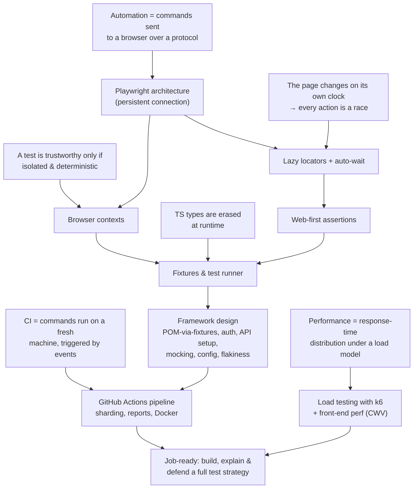

# I am a QA Engineer, I mainly used WebdriverIO in the last 3 years, and now I want to apply to new jo

*2026-10-07*

---

### You

/teach I am a QA Engineer, I mainly used WebdriverIO in the last 3 years, and now I want to apply to new jobs and see that most of the jobs descriptions require Playwright. I would like to start to lean Playwright, but not only the core concepts, I want to get more deep into it, to learn the industry standards, to know the industry standards design patterns that you can apply when developing/expanding/maintaining a playwright automation framework, and everything that relates to advanced knowledge related to automation concepts using Playwright specifically. I would also like to learn some other concepts that I have an idea about, but never went that deep into, things like Load and Performance testing, industry tools that can help you achieve this in the most efficient ways, CI/CD, implementing pipelines from scratch etc.

---

### Claude

> [!question] Quiz 1/4
> In WebdriverIO v8 (async mode), a test contains the line `$('#submit').click();` with no `await`. What happens?
>
> 1. Fails with missing-await error — The test fails immediately with a missing-await error
> 2. Next line may run first — The click is scheduled, but the next line may run before it finishes
> 3. Command queue keeps order — WDIO's command queue still runs the click before the next line
> 4. I don't know

> [!question] Quiz 2/4
> In Playwright, `const btn = page.locator('.buy');` — when does Playwright look up the matching DOM element?
>
> 1. Immediately on creation — When the locator is created
> 2. Fresh on every use — Again on every action or assertion that uses it
> 3. First use, then cached — On the first action, then the element is cached for reuse
> 4. I don't know

> [!question] Quiz 3/4
> By default, Playwright Test runs two tests from the same file. What do they share?
>
> 1. Browser only, fresh context — The browser process only; each test gets a fresh context
> 2. Nothing at all — Nothing; each test launches its own browser process
> 3. Browser and context — The browser and the context; cookies carry over between tests
> 4. I don't know

> [!question] Quiz 4/4
> A GitHub Actions workflow defines jobs `lint` and `test`, with no `needs:` key. How do they run?
>
> 1. Sequential, one runner — Sequentially, in the order written, on one runner
> 2. Parallel, shared runner — In parallel, on the same runner, sharing a workspace
> 3. Parallel, separate runners — In parallel, each on its own fresh runner
> 4. I don't know

---

### You

**Your answer:** Next line may run first
**Your answer:** I don't know
**Your answer:** I don't know
**Your answer:** I don't know

---

### Claude

> [!question] Quiz 1/4
> In classic WebDriver mode, how does WebdriverIO get Chrome to perform a click?
>
> 1. HTTP request to a driver — Sends an HTTP request to a driver process (e.g. chromedriver), which controls the browser
> 2. Injects JS into the page — Injects JavaScript into the page that calls element.click()
> 3. Direct WebSocket to browser — Talks directly to the browser over one persistent WebSocket
> 4. I don't know

> [!question] Quiz 2/4
> A load test reports: average response time 200 ms, p95 = 1.8 s. Which statement is true?
>
> 1. Most requests took ~1.8 s — 95% of requests took about 1.8 s
> 2. 5% took at least 1.8 s — 5% of requests took 1.8 s or longer
> 3. Slowest request was 1.8 s — The single slowest request took 1.8 s
> 4. I don't know

> [!question] Quiz 3/4
> What makes a test a *stress* test rather than a plain load test?
>
> 1. Expected load, many hours — It runs the expected load for many hours
> 2. Instant jump to expected load — It jumps instantly to the expected load to simulate a spike
> 3. Beyond peak, find breaking point — It pushes past the expected peak to find the breaking point
> 4. I don't know

> [!question] Quiz 4/4
> A TypeScript function is declared as `function f(x: number)`. At runtime, plain JS calls `f("hello")`. What happens?
>
> 1. Throws a TypeError — The runtime checks the type and throws a TypeError
> 2. Coerces to a number — The value is converted to a number (NaN)
> 3. Runs with the string — The function runs normally with the string
> 4. I don't know

---

### You

**Your answer:** HTTP request to a driver
**Your answer:** 5% took at least 1.8 s
**Your answer:** Expected load, many hours
**Your answer:** Throws a TypeError

---

### Claude

> [!question] Language
> Which language should we use for Playwright?
>
> 1. TypeScript (Recommended) — What most Playwright job ads expect, and the best-supported option
> 2. JavaScript — What you may have used with WDIO; we'd add types later
> 3. Java / Python / C# — If your target jobs ask for a specific non-JS stack

> [!question] Style
> How do you want sessions to feel?
>
> 1. Concepts + hands-on build — Learn each idea, then apply it to a real framework we grow in a project folder
> 2. Mostly conceptual — Understand deeply, and practice on your own
> 3. Interview-oriented — Concepts plus framing them the way interviewers ask about them

> [!question] Priority
> What should come first after Playwright fundamentals?
>
> 1. Playwright depth first — Framework architecture and patterns, then CI/CD, then load/perf
> 2. Interleave with CI early — Get the framework running in a pipeline early, then deepen both
> 3. Breadth first — A quick pass over everything, then go deep

> [!question] Pace
> How much time can you put in?
>
> 1. Intensive (daily, 1-2h) — Applying soon, want job-ready quickly
> 2. Steady (few times/week) — Ongoing learning alongside work
> 3. Ad hoc — Whenever I have time

---

### You

**Your answer:** I used plain JS for WebriverIO, but I would like to use TypeScript for Playwright
**Your answer:** can we do a mix between concepts + hands-on build + interview-oriented?
**Your answer:** Breadth first
**Your answer:** Intensive (daily, 1-2h)

---

### Claude

> [!question] Plan
> Start with this plan?
>
> 1. Start with this plan — Begin Pass 1, Session 1: Playwright architecture → locators → auto-wait
> 2. Change something — Adjust order, scope, or format first

> [!question] Target app
> For hands-on practice, what should our tests run against?
>
> 1. Public demo app (Recommended) — e.g. a practice e-commerce/todo site plus a public demo API; zero setup
> 2. Local app in the repo — A small app we run locally; full control, enables mocking & perf tests safely
> 3. Something I choose — You name an app or site you have permission to test

I've checked the facts against current sources: Playwright docs (latest stable **v1.63**), Grafana k6 docs, web.dev and GitHub Docs. Here's the plan.

## The approach

You asked for **breadth first**, so we'll take **two passes**:

- **Pass 1, breadth (about 4–5 sessions):** one session each for Playwright core, framework design, CI/CD and performance. Each session covers the core truths of its area and ends with something small that runs. By the end you'll have a TypeScript Playwright suite running in a GitHub Actions pipeline, plus a first k6 load script. You'll be able to talk about all four areas in an interview.
- **Pass 2, depth:** we go back through the same map and cover the advanced material. That includes fixtures in depth, the POM-via-fixtures pattern, auth with `storageState` and setup projects, network mocking, API testing, visual and ARIA snapshots, flaky-test strategy, sharding with merged reports, Docker, open vs closed load models, thresholds, and Core Web Vitals.

**Why this order:** almost everything Playwright does differently from WDIO follows from **two facts**:
1. It controls the browser over a *persistent two-way connection*, not one HTTP request per command. You already understand the HTTP model, so this contrast is a natural starting point.
2. The page changes on its own schedule, so every interaction is a race and the tool has to do the waiting. Lazy locators, auto-waiting and retrying assertions all follow from this, and so does the fact that there's no `browser.pause()` habit.

Test isolation leads to browser contexts, and contexts lead to fixtures, which are the basis of modern Playwright framework design. Your misconception about TypeScript types at runtime gets fixed early, because the framework code depends on it.

**Each session:** concept nodes with quizzes → apply them in a real project (`playwright-lab/`, which we'll set up here) → 2–3 interview-style questions, with feedback on how you'd phrase your answers.

## Dependency map



Note that k6's terms will set your stress-vs-soak distinction straight (smoke, average-load, stress, soak, spike, breakpoint), and it uses the percentile thinking you already have.

---

### You

**Your answer:** Start with this plan
**Your answer:** Can we use the qa-learning-app project that I already have? It is already deployed on https://www.code-assured.com/ or I can start it locally to no interfere with the data that is already live. The project is on D:\Dev Stuff\QA Learning App , It already has a suite of tests ran with playwright, but I haven't developed it myself, Claude did it automatically. So we can use this project to build it again, manually from scratch, is it a good idea?

---

### Claude

> [!question] Quiz
> With a pure HTTP request/response protocol (classic WebDriver), which of these can the browser NOT do for your test?
>
> 1. Run JavaScript in the page — Execute a script inside the page and return the result
> 2. Screenshot the page — Capture the current page as an image and return it
> 3. Report events as they happen — Tell the test the moment a network request fires or a console message appears
> 4. I don't know

---

### You

**Your answer:** I don't know

---

### Claude

> [!question] Quiz
> Playwright's `page.route('**/api/orders', handler)` lets a test intercept a request and return fake data. What makes that possible?
>
> 1. Browser pauses, asks the test — The browser pauses the request and asks the test what to do over the open connection
> 2. Tests run inside the page — Playwright tests execute inside the page's own JavaScript context
> 3. Built-in proxy server — Playwright routes all traffic through a local proxy server it starts
> 4. I don't know

**The answer:** report events as they happen. Running JavaScript and taking screenshots both fit request/response: you ask, it answers. But suppose the page fires a network request at some unpredictable moment. With pure request/response, the browser has no way to start that conversation. It can only answer, so the test has to keep polling ("anything new? anything new?").

### The move Playwright makes

If the problem is that the browser can't speak first, the fix is a connection that stays open in **both directions**. Playwright works like this:

```
your test (Node)  ⇄  Playwright driver  ⇄  browser
                  persistent           browser's own protocol:
                  connection           • Chromium: CDP (Chrome DevTools Protocol)
                                       • Firefox/WebKit: Playwright's patched builds
```

The connection stays open for the whole session, and messages can go either way. Several features you'll use every day follow directly from that:

| Because the browser can push messages… | …Playwright can offer |
|---|---|
| events arrive the moment they happen | `page.on('request')`, `page.on('console')`, `page.waitForResponse(...)` |
| the browser can *pause* a request and ask the test what to do | network interception and mocking with `page.route()` |
| waiting logic runs right next to the browser instead of over repeated HTTP calls | fast, built-in auto-waiting (Node 3) |
| one connection can carry many isolated sessions | cheap browser contexts (Node 5) |

**An accuracy note:** this direction is where the industry is heading too. WebdriverIO now starts local sessions on **WebDriver BiDi** by default. BiDi is the W3C's two-way successor to classic WebDriver. So in an interview, a better answer than "Selenium is slow" is: *"Classic WebDriver is request/response over HTTP. Playwright was designed from the start around a persistent two-way connection, which is why events, interception and auto-waiting are built in. The standards world is converging on the same idea with BiDi."*

**Connects to:** T1 (it's still a client sending commands; only the shape of the conversation changed).

Quick check that this has landed:

---

### You

**Your answer:** Browser pauses, asks the test

---

### Claude

> [!question] Quiz
> Given that the page can replace DOM nodes at any time, when is the only reliably safe moment to find the element you want to act on?
>
> 1. Once at test start — Find it once at the start of the test and reuse the reference
> 2. Right before each action — Find it again immediately before every action or check
> 3. Once after page load — Find it once after the load event fires, then reuse it
> 4. I don't know

---

### You

**Your answer:** Right before each action

---

### Claude

> [!question] Quiz
> The page shows two buttons named "Delete". The test runs `await page.getByRole('button', { name: 'Delete' }).click()`. What happens?
>
> 1. Clicks the first match — It clicks the first matching button in DOM order
> 2. Clicks both buttons — It clicks every matching button in turn
> 3. Throws an error — It throws a strict mode violation error
> 4. I don't know

---

### You

**Your answer:** Clicks the first match

---

### Claude

> [!question] Quiz
> A list has 5 items matching `page.getByRole('listitem')`. Which call runs WITHOUT a strict mode error?
>
> 1. await items.count() — const items = page.getByRole('listitem'); await items.count()
> 2. await items.click() — const items = page.getByRole('listitem'); await items.click()
> 3. await items.textContent() — const items = page.getByRole('listitem'); await items.textContent()
> 4. I don't know

---

### You

**Your answer:** I don't know

---

### Claude

> [!question] Quiz
> Same 5 list items. Which call THROWS a strict mode error?
>
> 1. items.allTextContents() — await items.allTextContents()
> 2. items.nth(2).click() — await items.nth(2).click()
> 3. items.getAttribute('id') — await items.getAttribute('id')
> 4. I don't know

---

### You

**Your answer:** items.getAttribute('id')

---

### Claude

> [!question] Quiz
> After a dialog closes, a transparent overlay stays on top of the Save button for 300 ms. The test runs `await save.click()` immediately. What does Playwright do?
>
> 1. Clicks the overlay — Clicks at the button's position right away; the overlay receives it
> 2. Waits, then clicks Save — Retries until the button is the hit target, then clicks it
> 3. Fails instantly — Fails immediately with an 'element click intercepted' error
> 4. I don't know

---

### You

**Your answer:** I don't know

---

### Claude

> [!question] Quiz
> A Submit button is `disabled` for 1 second while the form validates. The test runs `await submit.click()` right away. What happens?
>
> 1. Clicks immediately, no effect — The click is sent immediately and the disabled button ignores it
> 2. Throws 'not interactable' — It throws an 'element not interactable' error immediately
> 3. Waits ~1 s, then clicks — It retries until the button is enabled, then clicks
> 4. I don't know

No response requested.

---

### You

The app was quit while you were working. Please continue from where you left off.

---

### Claude

> [!question] Quiz
> A Submit button is `disabled` for 1 second while the form validates. The test runs `await submit.click()` right away. What happens?
>
> 1. Clicks immediately, no effect — The click is sent immediately and the disabled button ignores it
> 2. Throws 'not interactable' — It throws an 'element not interactable' error immediately
> 3. Waits ~1 s, then clicks — It retries until the button is enabled, then clicks
> 4. I don't know

Picking up where we stopped. We're in Node 3 (auto-waiting), and this is the check question that got cut off.

---

### You

**Your answer:** Waits ~1 s, then clicks

---

### Claude

> [!question] Quiz
> After `await save.click()`, a "Saved" toast appears ~500 ms later. `const toast = page.getByText('Saved')`. Which assertion is reliable?
>
> 1. expect(await isVisible()) — expect(await toast.isVisible()).toBe(true)
> 2. await expect(toast).toBeVisible() — await expect(toast).toBeVisible()
> 3. expect(toast).toBeTruthy() — expect(toast).toBeTruthy()
> 4. I don't know

---

### You

**Your answer:** await expect(toast).toBeVisible()

---

### Claude

> [!question] Quiz
> An order's status changes from "Pending" to "Paid" ~2 s after payment. This line is flaky: `expect(await status.textContent()).toBe('Paid')`. Which rewrite fixes it?
>
> 1. await expect(await ...) — await expect(await status.textContent()).toBe('Paid')
> 2. expect(status) without await — expect(status).toHaveText('Paid')
> 3. await expect(status).toHaveText — await expect(status).toHaveText('Paid')
> 4. I don't know

---

### You

**Your answer:** await expect(await ...)

---

### Claude

> [!question] Quiz
> Which of these assertions will RETRY until the condition is true (or timeout)?
>
> 1. await expect(cart).toContainText('3 items') — const cart = page.getByTestId('cart-count')
> 2. await expect(await cart.innerText()).toContain('3') — const cart = page.getByTestId('cart-count')
> 3. await expect(await cart.count()).toBe(1) — const cart = page.getByTestId('cart-count')
> 4. I don't know

---

### You

**Your answer:** await expect(cart).toContainText('3 items')

---

### Claude

> [!question] Quiz
> Test 1 logs into the QA Learning App. Test 2, in the same file, then opens the dashboard URL directly. By default, what does Test 2 see?
>
> 1. Dashboard, still logged in — The dashboard, because the browser is shared and keeps the session cookie
> 2. Redirect to the login page — The login page, because Test 2 has a fresh context with no session cookie
> 3. Depends on test order — Either one, depending on which worker ran Test 1 first
> 4. I don't know

✓ **Correct.** There's a locator inside `expect()`, so it retries. The other two read a value (`innerText()`, `count()`) *before* `expect` sees it, so they're snapshots. For a count, the retrying form is `await expect(cart).toHaveCount(1)`. Node 4 is solid.

---

## Node 5: Browser contexts (isolation)

**Unconditional truth T3:** *A test result is trustworthy only if it depends on nothing except the code under test.* If test B passes only because test A left a login cookie behind, B is measuring the *run order*, not the app. That's where "passes alone, fails in the suite" bugs come from.

So every test needs a clean browser state. Here are the options, each with its cost:

| Option | Clean? | Cost |
|---|---|---|
| Launch a new browser per test | ✅ fully | 🐢 slow: a whole new process every time |
| Reuse one browser, clear cookies between tests | ❌ leaks: localStorage, sessionStorage, IndexedDB, permissions, service workers… | 🐇 fast |
| **Reuse the browser process, create a new *context* per test** | ✅ fully | 🐇 fast: a few milliseconds |

A **BrowserContext** is like an **incognito profile**: its own cookies and storage, completely isolated from other contexts, even though they run inside the same browser process. The hierarchy:

```
Browser (one process, shared by tests in a worker)
 └─ BrowserContext (one per test: a fresh incognito-like profile)
     └─ Page (a tab inside that context)
```

Playwright Test does this automatically: **every test gets a fresh context and page, while the browser is shared.** In WDIO terms, it's like getting `reloadSession()` isolation per test without paying for a new session.

There's a bonus that interviewers like: you can create **two contexts in one test**. That gives you two fully separate users, for example an admin approving an order while a customer watches its status change. Single-session tools find that kind of test hard to write.

**Connects to:** T3 (isolation), and Node 1 (one connection can carry many contexts cheaply).

Now back to a probe question you didn't know at the start:

---

### You

**Your answer:** Redirect to the login page

---

### Claude

> [!question] Quiz
> Using the fixture file above, what runs for the test `'sees login form'`, which only requests `{ page }`?
>
> 1. Only the test body — Only the test body, with a fresh page; loginViaUI and logoutViaUI never run
> 2. Login, body, logout — loginViaUI, then the test body, then logoutViaUI
> 3. Login, body (no logout) — loginViaUI, then the test body; teardown is skipped because the fixture wasn't used
> 4. I don't know

✓ **Correct.** Test 2 has a fresh context with no session cookie, so the app redirects it to login. Compare that with where you started this session: you didn't know this, and now you can derive it from T3 plus contexts. Node 5 is solid.

---

## Node 6: Fixtures (the basis of Playwright framework design)

**Motivation:** Node 5 leaves you with a practical problem. If every test starts logged out, how do 40 tests each get a logged-in page without 40 copy-pasted login blocks? And where does `page` come from in `async ({ page }) => …` in the first place?

In WDIO you'd use `beforeEach` plus a shared `let` variable. That has three weaknesses:
1. It runs for **every** test in scope, including tests that don't need it.
2. State passes through outer variables, which is easy to break and has no types.
3. Teardown is a separate `afterEach` that you have to remember to keep in sync.

Playwright's answer is the **fixture**: a named piece of setup that a test *asks for by name*, and that has its setup and teardown in one function:

```ts
import { test as base, Page } from '@playwright/test';

export const test = base.extend<{ loggedInPage: Page }>({
  loggedInPage: async ({ page }, use) => {   // a fixture can request other fixtures
    await loginViaUI(page);                  // SETUP
    await use(page);                         // ⏸ the test runs here
    await logoutViaUI(page);                 // TEARDOWN (runs even if the test failed)
  },
});

test('sees dashboard', async ({ loggedInPage }) => { … });  // asks for it → gets it
test('sees login form', async ({ page }) => { … });         // doesn't ask → it never runs
```

What follows from that design:
- **On demand:** a fixture runs only if a test (or another fixture) asks for it.
- **Composable:** fixtures request other fixtures. `page` itself is a built-in fixture that depends on `context`, which depends on `browser`. That's the Node 5 hierarchy, built from fixtures.
- **Scoped:** the default is per test. `{ scope: 'worker' }` sets a fixture up once per worker process, which suits expensive things like a seeded database or an auth token.
- **Typed:** `base.extend<{ loggedInPage: Page }>` gives you autocomplete and compile errors. Remember T4, though: that type is **erased at runtime**. It's a promise the compiler checks, not a check that runs while the test does. That will matter in Pass 2 when we type API responses.

This is why the industry-standard Playwright framework is **POM via fixtures**: page objects are created in fixtures and injected into tests (`async ({ checkoutPage }) => …`) rather than `new`ed by hand.

**Connects to:** Node 5 (contexts are fixtures), T3 (each test still gets fresh state) and T4 (types).

---

### You

**Your answer:** Only the test body

---

### Claude

> [!question] Location
> Where should your new from-scratch framework live?
>
> 1. Separate repo (Recommended) — e.g. D:\Dev Stuff\qa-learning-app-e2e — its own Git repo and package.json, pointing at the app's URL. Mirrors many real QA teams, makes a clean portfolio repo, and avoids colliding with the existing Claude-made suite
> 2. Inside the app repo — A new folder (e.g. e2e/) in QA Learning App, next to the old tests; closer to 'tests live with the code' setups

> [!question] Next
> What next?
>
> 1. Hands-on now — Start the local app and scaffold the project together
> 2. Interview drill first — 3 interview-style questions on today's concepts, then hands-on
> 3. Stop for today — Recap and pick up next session

---

### You

**Your answer:** Separate repo (Recommended)
**Your answer:** Stop for today

---

### Claude

That's a good place to stop.

## Session 1 recap

**Solid now:**
1. **Architecture:** Playwright keeps a persistent two-way connection to the browser, while classic WebDriver sends one HTTP request per command. The browser can therefore send messages first, which is what makes events, `page.route()` interception and fast auto-waiting possible. WDIO's move to BiDi is the industry heading the same way.
2. **Locators are recipes:** they're resolved again on every use, so there are no stale elements and no `await` when you create one. Strictness means single-target operations throw on several matches. Use `.first()` or `.nth()` when you really mean one of many.
3. **Auto-waiting:** before acting, Playwright checks Visible, Stable, Receives Events and Enabled (or Editable), applying each only where it makes sense. An action fails only if the checks are still failing when the timeout runs out.
4. **Web-first assertions:** a locator inside `expect()` plus `await` in front means it retries (default 5 s). A value inside `expect()` is a snapshot and never retries.
5. **Contexts:** each test gets a fresh incognito-like context, while the browser process is shared.
6. **Fixtures:** setup, `use()` and teardown in one function. They run only when a test asks for them, they compose, and they're typed. This is the basis for POM via fixtures.

**Watch these:** two old WDIO habits caused your misses: expecting "first match wins", and thinking `await expect(await x.textContent())` retries. Next session opens with a quick check on both.

## Next session
1. **Hands-on:** create the separate repo `D:\Dev Stuff\qa-learning-app-e2e`, start the app locally (`docker compose` for Postgres, then `pnpm dev` on port 3200), and write your first tests against the login and dashboard flows yourself, with me reviewing.
2. **Interview drill:** three questions on today's material, with feedback on how you phrase your answers.
3. Then Pass 1, Session 2: framework design.

Please don't open the existing Claude-written suite in the app repo yet. Reviewing it after we've built our own is one of the exercises.

To resume, say **"continue playwright"**. I've saved your decisions (TypeScript, breadth-first, local app only, separate repo) so the next session can pick them up.

---

### You

As I am not that familiar with the syntax and it's architecture of Playwright yet, I was thinking that you could maybe build like a "cheat-sheet" for me like it exists for git (https://git-scm.com/cheat-sheet) that explains the most used commands and what they should be used for or something like that, do you think that would be a good idea?

---

### Claude

Yes, it's a good idea, with one change from the git version. A plain list of commands is what we've been avoiding: facts with no connections between them. So I'll organize the sheet by the same map you learned today. Each section starts with the one-line *reason* the commands exist ("locators are recipes", "assertions retry"), so a command you look up reminds you of the idea behind it. Two more things that suit your situation:

- **A WDIO → Playwright column**, so you can translate from what you already know.
- **A "traps" section** with the two WDIO habits that tripped you today.

I'll make it a page you can keep open and come back to, and we'll add to it as Pass 1 continues.

I've made you a Playwright cheat sheet: **[Playwright Field Sheet](https://claude.ai/artifact/Vngf1zzvtUjr6wt6aeSpRA)**. It's private to you, and the source file is [cheatsheets/playwright-cheatsheet.html](cheatsheets/playwright-cheatsheet.html).

It's like the git cheat sheet, with a few changes to fit how we're learning:

- **Organized by why, not alphabetically.** It opens with the four facts from today: the architecture, the page changing on its own schedule, isolation, and erased types. Each section then starts with the line that explains its commands. For example, the assertions section opens with "a locator inside `expect()` plus `await` = retries."
- **A CLI section in the git-sheet style:** the `npx playwright …` commands you'll use daily, each with what it's for.
- **Sections on** locators, actions, assertions, contexts, fixtures, config, debugging, and network/API, each with a code snippet you can copy.
- **A WebdriverIO → Playwright table** that says *what changes*, not just the new name.
- **A traps section** that starts with the two habits that caught you today.
- **Status tags:** green means taught and quizzed, and blue "COMING UP" marks a preview of a later session. That way it doesn't look as if you're expected to know everything already.
- **A filter box at the top**, so you can type `route` or `toHaveText` to jump straight to it.

Use it as a lookup while you write code, not as something to memorize. When you look something up, read that section's first line too: that's the idea that will help you remember it. I'll update the tags after each session and republish to the same link.

To pick up where we left off, say **"continue playwright"**. We'll start by setting up your test repo and writing your first tests against the local app.

---

### You

continue playwright

---

### Claude

> [!question] Quiz 1/2
> The Orders page has 3 rows, each with an "Edit" link. Which line runs WITHOUT throwing?
>
> 1. getByRole('link',{name:'Edit'}).click() — await page.getByRole('link', { name: 'Edit' }).click()
> 2. ...getAttribute('href') — await page.getByRole('link', { name: 'Edit' }).getAttribute('href')
> 3. ...nth(1).click() — await page.getByRole('link', { name: 'Edit' }).nth(1).click()
> 4. I don't know

> [!question] Quiz 2/2
> A badge shows "0" and updates to "3" about 1 s after items are added. Which assertion is reliable?
>
> 1. await expect(badge).toHaveText('3') — await expect(badge).toHaveText('3')
> 2. await expect(await badge.innerText()).toBe('3') — await expect(await badge.innerText()).toBe('3')
> 3. expect(badge).toHaveText('3') — expect(badge).toHaveText('3')  (no await)
> 4. I don't know

Welcome back. As planned, we start with a quick check on the two traps from Session 1, then set up your test repo.

---

### You

**Your answer:** ...nth(1).click()
**Your answer:** await expect(badge).toHaveText('3')

---

### Claude

Your machine has everything installed (Node 24, pnpm, git, Docker), but **Docker Desktop isn't running**, and the app needs it for Postgres. The app's README lists seeded demo accounts we can use: `learner@example.com`, the admin, and the `demo.*` learners. Their passwords are in the README's "Seed Database" section.

## Step 1: Start the app locally (in the app folder)

Start **Docker Desktop** first, then run these in a terminal in `D:\Dev Stuff\QA Learning App`:

```bash
pnpm db:up
```
```bash
pnpm prisma migrate deploy
```
```bash
pnpm db:seed
```
```bash
pnpm dev
```

Leave `pnpm dev` running and open http://localhost:3200 to check the app loads. (`db:seed` wipes local learner progress. That's what we want here: a known starting state, which is T3 applied to the database.)

## Step 2: Create your test repo (in a second terminal)

```bash
mkdir "D:\Dev Stuff\qa-learning-app-e2e"
```
```bash
cd "D:\Dev Stuff\qa-learning-app-e2e"
```
```bash
git init
```
```bash
npm init playwright@latest
```

Answer the prompts like this:
- **TypeScript**
- tests folder: **`tests`**
- **GitHub Actions workflow: No.** You said you want to build pipelines from scratch, so we'll write it ourselves in the CI session instead of having it generated.
- install browsers: **Yes**

Then open `playwright.config.ts` and make two edits. Both come from the cheat sheet's Config section:
1. Uncomment `baseURL` and set it to `'http://localhost:3200'`.
2. In `projects`, keep only `chromium` for now. Three browsers would triple the run time while you're learning.

Delete the generated `tests/example.spec.ts`.

## Step 3: Write your first spec yourself

Create `tests/auth.spec.ts` with **three tests**. Use the cheat sheet. Use `npx playwright codegen localhost:3200` only to *find locators*, not to write the tests for you.

1. **Valid login:** a seeded learner logs in and lands on the dashboard. Assert the URL *and* something the user can see.
2. **Wrong password:** stays on the login page and shows an error message.
3. **Protected route:** opening `/dashboard` with no login sends you to the login page. (Remember the quiz from Node 5: why can this test assume it starts logged out?)

Rules for this exercise:
- Use user-facing locators (`getByRole`, `getByLabel`) wherever the app allows it.
- Use web-first assertions only, with no `waitForTimeout`.
- **It's fine to hardcode the credentials for now.** You'll notice the duplication and the plain-text secrets, and that annoyance is the reason for what we cover in Session 2 (fixtures, page objects, env config). It's easier to see why a pattern exists after you've felt the problem it fixes.

Run them with `npx playwright test --ui`. When all three pass, or you get stuck on one, **paste your `auth.spec.ts` here** (or just tell me it's ready and I'll read it from the folder). I'll review it the way a senior engineer would in a PR.

---

### You

I finished writing the three tests, auth.spec.ts can be found in D:\Dev Stuff\qa-learning-app-e2e\tests\auth.spec.ts

---

### Claude

I'll run the suite before reviewing, so the review is based on what actually happens and not only on reading the code.

> [!question] Quiz
> Test 1 registers `testEmail${Math.floor(Math.random()*10000)}@test.com`. Your local DB keeps every registered user until the next `db:seed`. What will eventually happen as you keep running the suite?
>
> 1. Nothing, 10,000 is plenty — Collisions are too unlikely to matter at this scale
> 2. Random 'email taken' failures — It starts failing now and then with an 'email already registered' error
> 3. Fails only when run in parallel — It fails only when two workers run the test at the same moment
> 4. I don't know

All **9 runs passed** (3 tests × 3 repeats, 9.4 s), so nothing is flaky right now. That's a good first suite. Here's the review, written the way I'd write it on a PR.

## What's already good ✅
- **Mostly user-facing locators** (`getByRole` with accessible names).
- **You scoped a locator to avoid strict mode:** `getByRole('navigation', …).getByRole('link', …)`. That's Node 2 used without anyone telling you to.
- **Web-first assertions only**, no sleeps, and every `await` is there.
- **`toHaveValue(email.toLowerCase())`** after registering is a good detail. You noticed the app normalizes the email and checked for it.
- **Test 3 needs no logout step** because each test starts in a fresh context (T3).

## Changes requested

**1. `baseURL` is configured but never used.** Every test hardcodes `http://localhost:3200`. The day you point the suite at staging, you'd have to edit every line.
```ts
await page.goto('/login');
await expect(page).toHaveURL(/\/login$/);
```

**2. `console.log('Step …')` is a WDIO habit. Use `test.step`.** Logs only go to the terminal. Steps show up as collapsible, timed blocks in the HTML report and the trace, and a failure points to the step it happened in:
```ts
await test.step('Fill out the login form and submit', async () => {
  await page.getByRole('textbox', { name: 'Email' }).fill(email);
  // ...
});
```

**3. Each test should go straight to the thing it tests.** Tests 2 and 3 start at the landing page and click through to login. That means the landing page's "Log in" link is now part of what *every* auth test checks. If that one link breaks, you get 3 red tests and a confusing triage. Test 2 is about the login error, so start with `page.goto('/login')`. In test 3, Step 1 isn't testing anything, so delete it. (Test 1 can keep its landing-page click if you count "start your first project → register" as part of the user journey you're testing. That's a judgement call, so make it on purpose.)

**4. The XPath for the user's name in the header is the last-resort locator.** It's also tied to markup (`header//span`). Try:
```ts
await expect(page.getByRole('banner').getByText(email.toLowerCase())).toBeVisible();
```
(A top-level `<header>` usually has the `banner` role. Check it in UI mode's locator picker.)

**5. Test 3 checks three routes in one test.** If `/stages` stops redirecting, the test stops there and you never find out whether `/dashboard` and `/labs` are fine. One test per route gives you three separate results, and a loop keeps it to a few lines:
```ts
for (const path of ['/stages', '/dashboard', '/labs']) {
  test(`${path} redirects anonymous users to login`, async ({ page }) => {
    await page.goto(path);
    await expect(page).toHaveURL(/\/login$/);
  });
}
```
This is called a **data-driven** (parameterized) test, and interviewers often ask about it.

**6. Delete `tests/example.spec.ts`.** It's still there and runs against playwright.dev, which is an external site (and the best-practices page says not to test third-party sites).

**7. The random test data has a hidden time bomb.** I'll ask this one as a question, because you can reason it out:

---

### You

**Your answer:** [User dismissed — do not proceed, wait for next instruction]

---

### Claude

You closed the question, so I'll stop here and wait. When you're ready, you can:

- answer the collision question (just tell me your answer),
- make the six fixes above and tell me they're done, and I'll re-run and review again,
- or ask about anything in the review.

---

### You

I tried updating the redirect test to this form:

<pasted_content id="f301">
test('Protected pages redirect to Login', async ({ page }) => {

    for (const [index, value] of ['/stages', '/dashboard', '/labs'].values()) {
        await test.step(`Step ${index + 1}: Navigate to ${value} page and validate redirect to login`, async () => {
            await page.goto(value);
            await expect(page).toHaveURL('/login');
        });
    }
});
</pasted_content id="f301">

but it fails, it redirects to localhost:3200/s instead of stages, an in the log it prints Step /1 

What are the causes, also, I have updated the tests, please take a look at them again.

The response to the question is Random 'email taken' failures.

---

### Claude

> [!question] Quiz
> With the fixed loop (one test, three `test.step`s), a bug breaks only the `/stages` redirect. What does the test report tell you about `/dashboard` and `/labs`?
>
> 1. Both shown as passed — Their steps are reported as passed, the /stages step as failed
> 2. Nothing, they never ran — Their steps never ran, so their status is unknown
> 3. Both shown as failed — All three steps are marked failed, because the test failed
> 4. I don't know

✓ **Correct on the quiz: random "email taken" failures.** It also happens sooner than most people expect. Each run adds one user to a database that's never cleaned, so run $n$ collides with probability $\frac{n-1}{10000}$, and it only gets worse. Over all the runs together, this is the birthday problem: the chance that *some* two runs got the same number is

$$P(\text{collision}) \approx 1 - e^{-n^2/(2 \cdot 10000)}$$

which passes **50% at around $n \approx 118$ runs**. That's just a few weeks of CI. The fix is to make uniqueness guaranteed instead of likely:

```ts
const id = crypto.randomUUID().slice(0, 8);           // or: `${Date.now()}-${test.info().workerIndex}`
const email = `qa-${id}@test.com`;
```

## Why the loop broke: `/s` and `Step /1`

Two separate things went wrong, and both come from one line:

```ts
for (const [index, value] of ['/stages', '/dashboard', '/labs'].values())
```

- `.values()` yields **just the strings**: `'/stages'`, then `'/dashboard'`, and so on.
- `const [index, value] = '/stages'` then **destructures the string itself**, because strings are iterable character by character. So `index = '/'` and `value = 's'`.
- `page.goto('s')` resolves against `baseURL`, which gives `localhost:3200/s`. That page doesn't exist, so there's no redirect.
- `` `Step ${index + 1}` `` is `'/' + 1`. A string plus a number is string concatenation, so you get `'/1'`.

The method you meant is **`.entries()`**, which yields `[index, value]` pairs:

```ts
for (const [index, path] of ['/stages', '/dashboard', '/labs'].entries())
```

The interesting part is that **TypeScript didn't complain**. Destructuring a string is legal, so TypeScript inferred `index: string` and `value: string`, and everything type-checked. Types catch mistakes in *shape*, not mistakes in *meaning*. (Hover over `index` in VS Code and you'll see `string`. That hover would have caught it.)

Side note: your run confirmed that `toHaveURL('/login')` resolves against `baseURL` (the error shows `Expected: "http://localhost:3200/login"`). So the relative strings you used in the other tests are fine. I'd suggested a regex because I wasn't sure, and now you have proof.

## The bigger point: steps vs. tests

Even with `.entries()`, this is still **one test with three steps**, and not the three separate tests I suggested. Here's why that matters:

---

### You

**Your answer:** Nothing, they never ran

---

### Claude

✓ **Correct.** A failing step throws, and that ends the test, so the later steps never run. You'd fix `/stages`, re-run, and only then find out whether `/dashboard` is broken too. That's one bug at a time, one CI run each. With **separate tests**, each route gets its own pass/fail result in a single run. Since you have `fullyParallel: true`, they also run *in parallel*.

The rule of thumb: **`test.step` organizes *one* behaviour into readable phases. A separate `test` checks a separate behaviour.** "/stages redirects" and "/labs redirects" are separate behaviours. To get separate tests, put the loop *outside* `test()`:

```ts
for (const path of ['/stages', '/dashboard', '/labs']) {
  test(`${path} redirects anonymous users to login`, async ({ page }) => {
    await page.goto(path);
    await expect(page).toHaveURL('/login');
  });
}
```

Each test needs a **unique title**, which is why `${path}` goes in the name. Playwright rejects duplicate titles.

## Re-review of the rest
Fixed well: `baseURL` ✅, `test.step` ✅, test 2 goes straight to `/login` ✅, the `banner` locator instead of XPath ✅, `example.spec.ts` deleted ✅.

What's left:
1. **The redirect loop:** move it outside `test()` as shown above.
2. **Unique test data:** switch to `crypto.randomUUID()`, and remove the leftover `console.log('Set up test data')`.
3. Small one: test 1's Step 4 says "redirected to the dashboard" but checks `/stages`. Step names end up in reports, so they should match what's checked.

Make those three changes and tell me when they're done. I'll run the suite again, and then we'll move on to **Session 2: framework design**.

Have a look at your file before then. The login-form locators (`Email`, `Password`, `Log in`) are written out in **both** test 1 and test 2, and the learner's credentials are hardcoded. Imagine 40 tests like these and the day someone renames the "Log in" button. That's the problem page objects, fixtures and env config solve, and it's where Session 2 starts.

---

### You

I made the changes, re-check the file and run the tests

---

### Claude

> [!question] Next
> What next?
>
> 1. Interview drill — 3 interview-style questions on Session 1 (architecture, waiting, isolation); you answer in your own words, I give feedback on content and phrasing
> 2. Start Session 2 — Framework design: refactor auth.spec.ts with page objects via fixtures, env config, and logging in once with storageState
> 3. Stop for today — Pick up next time with the drill, then Session 2

---

### You

**Your answer:** Interview drill

---

### Claude

# Interview drill: Session 1

How this works: I ask one question at a time, the way an interviewer would. **Type your answer in your own words**, as you'd say it out loud, so roughly 60–90 seconds of speaking. Don't look at the cheat sheet, because the interviewer won't let you. For each answer I'll give feedback on:
- **content:** what's correct, what's missing, anything wrong;
- **structure and phrasing:** how to make it sound senior;
- **a model answer** you can compare against.

### Question 1 of 3

> *"Our team is currently on WebdriverIO and we're considering Playwright. From your experience with both, what are the main technical differences, and what would we actually gain or lose by switching?"*

(This is a common opener, and it's a gift for you: you have three years on one side and now understand *why* the other side works the way it does. The "lose" part is in there on purpose. Interviewers like to see that you can weigh trade-offs and aren't just enthusiastic about the new tool.)

---

### You

Both are great tools that come with their strong and weak points and I think, other then then the personal preferences of the team members that will develop and maintain the framework, technical aspects should be considered as well, to give you a more concise example, in the last project that I've been a part of, the decision to choose WebdriverIO was made due to the fact that the application under test was electron-based and WDIO offered great support for it, while Playwright only had to offer experimental-only features. If we have to consider which tool to pick from for a generic web-app, for an example, I would say that Playwright also has some strong and interesting points that would make me pick it, i.e the fact that Playwright has an inbuilt continuous bridge between the driver that makes the requests and the app, that would allow you to directly intercept the dynamic responses and events that come back from the applications, other strong points that Playwright has are the codegen and in-built GUIs for running the tests that are offered straight out of the box together with some other nice to have features like auto-waiting loading elements at the time of use for preventing stale elements.

---

### Claude

## Feedback on Q1

**What worked:**
- **The Electron example is your strongest moment.** It's specific, it's from real experience, and it's accurate: I checked, and Playwright's docs still say it has *"experimental support for Electron automation"*, while WDIO ships an integrated `@wdio/electron-service`. "We chose WDIO because of X" shows you pick tools for reasons, which is what this question is testing.
- You named the architectural difference (the persistent connection) and tied it to a practical benefit (intercepting responses and events). That's the connection most candidates miss.
- You mentioned codegen, UI mode, and the end of stale elements.

**What to improve:**
1. **Drop the opening sentence.** "Both are great tools… personal preferences" says nothing, and it can sound like you're hedging. Start with a clear claim instead. Your first sentence sets how confident you sound.
2. **You only half-answered "what would we lose".** For a generic web app you named the gains but not the costs. Good ones to include:
   - native **mobile apps**: WDIO + Appium handles them, while Playwright offers only emulation plus experimental Android;
   - **real branded Safari**: Playwright runs its own WebKit build, not Safari itself;
   - **the cost of migrating**: the existing suite, team retraining, and running two frameworks during the transition.
3. **You left out the biggest gains.** Mention **browser contexts**: isolation per test costs almost nothing, so parallel runs are cheap. Mention the **all-in-one runner**: fixtures, parallelism, sharding, retries with flaky detection, and **trace viewer** for debugging CI failures. Trace viewer is often the most convincing argument to a team lead.
4. **Make two phrasings more precise:**
   - "a continuous bridge between the driver that makes the requests and the app" → *"a persistent two-way connection to the browser, so the browser can push events instead of being polled"*.
   - "auto-waiting loading elements at the time of use" mixes two separate mechanisms. Split them: *"locators are resolved fresh at the moment of use, so no stale elements"* **and** *"every action auto-waits for actionability: visible, stable, enabled, receiving events"*. Keeping them apart shows you understand both.
5. **One sentence that makes you sound senior:** *"WDIO now defaults to WebDriver BiDi, so the protocol gap is narrowing. The bigger difference today is the integrated tooling."* It shows you know how the field is changing.

**A good structure for any "X vs Y" question:** the core difference → what follows from it → the trade-offs and when *not* to switch → your recommendation.

**Model answer (about 75 seconds):**
> "The core difference is architecture. Classic WebDriver is one HTTP request per command. Playwright keeps a persistent two-way connection to the browser, so the browser can push events. That's why it can intercept and mock network traffic, auto-wait close to the browser, and stream traces. WDIO's move to BiDi is narrowing that gap, so today the bigger difference is the tooling. Playwright gives you cheap browser contexts for isolated parallel tests, a runner with fixtures, sharding and flaky-test detection, and trace viewer, which makes debugging CI failures much faster.
>
> What you'd lose depends on the product. In my last project we stayed on WDIO because the app was Electron, and WDIO has a dedicated Electron service while Playwright's support is still experimental. The same applies to native mobile through Appium, or a hard requirement to test real Safari. There's also the migration cost.
>
> For a standard web app, I'd recommend Playwright and migrate step by step: write new tests in Playwright, move the most valuable or flakiest old ones first, and keep both suites in CI until the old one is retired."

Notice how your Electron story fits naturally into the "trade-offs" part. Your experience is the strongest thing you bring to this answer.

### Question 2 of 3

> *"A test passes every time on your machine, but fails about one run in five in the CI pipeline. Walk me through how you'd investigate it and what kinds of root causes you'd look for."*

(This tests whether Session 1 shows up in how you'd actually debug: think about waiting, isolation, and what Playwright gives you for finding out what happened.)

---

### You

Good question! From my experience, a flakiness issue such as this one usually has some usual causes (although not everytime, but it's very probable cause): 

1. the environment, is the local test run and the CI test run running on the same environment,  it can be the case that the CI is running the tests on an environment that is used by multiple teams or has much more traffic in comparison with the development build that may be used for testing locally.  
2. Does the CI machine maybe have lower resources so the runs are taking longer to execute and fail due to a timeout?


I think the first thing to do is to look at the results, more specifically at the step where the failure happened and try to isolate the issue, if, for example, the test fails on a default timeout check(so after 5 seconds it will fail because a certain element is not like how it was expected to be). Other then checking the logs, Playwright also offers you the tools to inspect what was exactly happening at the moment of failure, so it also makes it much more easier to pinpoint from the screenshots that the test was flaky because 1 in 5 times, the time it takes the element to load is longer and the timeout was exceeded before the element got the chance to finish loading.

---

### Claude

## Feedback on Q2

**What worked:**
- **You started from evidence**: find the failing step and see what state the app was in. That's the right instinct, and many candidates jump straight to guessing.
- **Environment and resource differences** are real, common causes, and you named them specifically (shared environment, more traffic, slower machines).
- You knew Playwright records what happened at the moment of failure.

**What to improve:**
1. **Cut "Good question!" and "usually… although not every time… very probable".** Hedging twice in the first sentence makes you sound less sure than you are.
2. **The biggest gap: you treated "slower CI" as the root cause.** A senior engineer would put it differently: *slower CI doesn't create the bug, it exposes a race that was always there.* If the fix is "raise the timeout", the question to ask is: *is the test waiting for the right condition?* Session 1 gives you the usual suspects:
   - **a non-retrying check:** `expect(await x.isVisible())`, which is a snapshot;
   - **a missing `await`**;
   - **listening too late:** `waitForResponse` registered *after* the click, so a fast response gets missed on some runs;
   - **a fixed `waitForTimeout`** tuned to how fast your laptop is.
3. **The other big category you missed: isolation (T3).**
   - CI often runs with a **different number of workers and in a different order** (your own config uses `workers: 1` on CI and full parallelism locally!).
   - **Tests share data**: two tests editing the same seeded user at the same moment, or the *random-email collision you found this week*. That's a good real example to use.
4. **Say "trace", not "screenshots".** A screenshot shows only the final state. The **trace** (`trace: 'on-first-retry'`, so CI records one automatically when a retry happens) shows DOM snapshots before and after *every* action, plus the network and the console. The trace is what lets you tell "the element was slow" apart from "the API returned 500" and "the test clicked before the data arrived".
5. **Say how you'd reproduce it.** `--repeat-each=20`, the same worker count as CI, and running inside the **same Docker image** CI uses.
6. **Mention that it might be a real bug.** A flaky test can be catching a genuine race in the *app*, such as a double-submit or an unhandled loading state. Saying this out loud stands out, because it shows you don't assume the test is always the problem.
7. **Close with prevention.** Don't just add retries. Quarantine the test (`test.fixme` plus a ticket) while you fix it, and track flaky rates: Playwright's report has a separate "flaky" category.

**Structure for any debugging question:** evidence → reproduce → classify the cause → fix the root cause, not the symptom → prevent it from happening again.

**Model answer (about 90 seconds):**
> "First I treat it as a race that CI exposes, not something CI causes, because slower or busier machines change the timing. I start with evidence: we record traces on the first retry, so I open the trace for a failing run and check the DOM, network and console at the failing step. That usually tells me whether the element was late, the API failed, or the test acted before data arrived.
>
> Then I try to reproduce it: `--repeat-each` with the same worker count as CI, ideally in the same Docker image.
>
> The causes I look for fall into three groups. One, the test waits for the wrong thing: a non-retrying assertion like `expect(await isVisible())`, a missing await, a `waitForResponse` registered after the click, or a hardcoded sleep. Two, isolation: tests sharing data or accounts, which only collides under CI's parallelism and ordering. I hit exactly that recently with randomly generated emails that weren't guaranteed to be unique. Three, environment: shared environments, third-party services, viewport or timezone differences. And sometimes it's a genuine race in the app, which is a bug to report, not hide.
>
> I fix the root cause rather than raising timeouts or relying on retries. While I'm fixing it, the test is quarantined with a ticket so it doesn't make the pipeline untrustworthy."

### Question 3 of 3

> *"We want to run our suite in parallel to cut CI time from 40 minutes to 10. What has to be true about the tests for that to work safely, and how does Playwright help, or not help, with that?"*

(The "or not help" part is deliberate again: there's one thing Playwright gives you for free and one thing it can't do for you.)

---

### You

Writing the test cases in accordance with the best practices, that would mean to make the best use out of the context, where each test gets a fresh context, that has it's own cookies and storage at almost no costs.

One more technique that Playwright offers and can be used in order speed up the run times is the sharding, which can be used for example in order to split the suite into multiple pieces such that they can be run on multiple CI machines.

---

### Claude

> [!question] Next
> Session 1 is fully done (concepts, hands-on suite, interview drill). What next?
>
> 1. Start Session 2 — Framework design: refactor auth.spec.ts with page objects via fixtures, env config for credentials, and logging in once with storageState
> 2. Stop for today — Recap now; say "continue playwright" to start Session 2 next time

## Feedback on Q3

**What worked:**
- **Fresh context per test** is the right starting point, and you described it accurately: own cookies and storage, almost no cost.
- **You brought up sharding without being asked.** We haven't covered it yet (it's marked COMING UP on the sheet), and you described it correctly: splitting the suite across several CI machines.

**What to improve:**
1. **This answer is too short for the question.** Two paragraphs on a question about going from 40 to 10 minutes reads as "I know the terms but haven't done it". You know more than you said, so spend it.
2. **"Writing the test cases in accordance with the best practices"** is vague. Interviewers hear it as filler. Name the practices.
3. **You missed the "or not help" half, which is the point of the question.** Contexts isolate the **browser** state. They do nothing for **server-side** state: the database, a shared user account, global app settings, a feature flag one test turns off. Playwright can't isolate those for you. That's the test author's job. What has to be true:
   - **No test depends on another test** having run, or on the order they run in.
   - **No shared mutable data.** Each test creates its own (unique!) data, or uses accounts it alone owns. Two tests editing `learner@example.com`'s profile at the same time will collide.
   - Global state that tests change (settings, flags) is avoided, or those tests are grouped and run serially on purpose.
4. **Name the two levels of parallelism.** They're different:
   - **workers**: parallel processes on *one* machine. `fullyParallel: true` lets tests *within a file* spread across workers too.
   - **shards**: the suite split across *several* machines (`--shard=1/4`), with the reports merged afterwards. One detail worth knowing: without `fullyParallel`, shards get whole files, so they can end up unevenly loaded.
5. **Bonus points for realism:**
   - 4× more parallel load also hits the **app and the database**. A test environment sized for one worker may start failing under four, which brings back Q2's flakiness.
   - The total time can't drop below **your slowest single test plus setup**.

**Model answer (about 75 seconds):**
> "Playwright handles half of it for free. Every test gets a fresh browser context, so cookies and storage never leak between tests. With `fullyParallel` and several workers per machine, plus sharding across CI machines with merged reports, 40 to 10 minutes is realistic.
>
> What Playwright can't do is isolate the backend, so the tests have to be written for it. No test can depend on another test or on run order. No two tests can change the same data, so each test creates its own uniquely named data, ideally through the API to keep it fast, or uses a dedicated account. Tests that change global things like feature flags either avoid it or are grouped to run serially.
>
> Before I turn parallelism up, I'd check two things: that the test environment can handle four times the concurrent load, because otherwise we've just swapped slowness for flakiness, and that no single slow test sets the floor. Then I'd roll it out with `--repeat-each` runs to catch hidden coupling early."

---

## Drill summary: patterns across your three answers

| Pattern | Seen in | Fix |
|---|---|---|
| **Filler or hedging openers** ("Both are great tools", "Good question!", "usually… not every time") | Q1, Q2 | Open with your thesis in the first sentence |
| **The right instinct in imprecise words** ("continuous bridge", "auto-waiting loading elements", "best practices") | Q1, Q3 | Use the exact terms: *persistent two-way connection*, *actionability*, *browser context*, *worker*, *shard* |
| **You answer what Playwright gives you and skip its limits** | Q1 (lose), Q3 (not help) | When a question has two sides, cover both. Senior answers are about trade-offs |
| ✅ **Real experience is your strongest asset** (the Electron story) | Q1 | Use a "in my last project…" example in every answer. Your WDIO years count here |

The knowledge from Session 1 is there. What needs work is how you **present it**, and that improves quickly with practice. I'll start each future drill by checking these three patterns.

---

### You

**Your answer:** Start Session 2

---

### Claude

> [!question] Quiz 1/2
> In a standard Page Object Model, what belongs inside a `LoginPage` class?
>
> 1. Locators + credential constants — The form's locators, plus the test learner's email and password as constants
> 2. Locators + login() action — The form's locators, plus a login(email, password) method that uses them
> 3. Locators only — Only the form's locators; tests perform every action themselves
> 4. I don't know

> [!question] Quiz 2/2
> Playwright can save a logged-in session to a `storageState` JSON file. What's in that file?
>
> 1. A recorded login script — The steps of the login flow, replayed at the start of each test
> 2. The full browser profile — The browser profile folder: cache, history, extensions and cookies
> 3. Cookies + local storage — The context's cookies and per-origin localStorage
> 4. I don't know

---

### You

**Your answer:** Locators + login() action
**Your answer:** I don't know

---

### Claude

> [!question] Quiz
> In a Playwright page object, is it safe to create locators once in the constructor, e.g. `this.emailInput = page.getByLabel('Email')`, before the page has even been opened?
>
> 1. No, use getters like WDIO — No; the element doesn't exist yet, so getters are still needed
> 2. Yes, nothing is looked up yet — Yes; it stores a recipe and looks the element up only when used
> 3. Only after page.goto() — Only if the constructor runs after page.goto() has finished
> 4. I don't know

---

### You

**Your answer:** Yes, nothing is looked up yet

---

### Claude

> [!question] Quiz
> Why can't a Playwright page object be a single shared instance exported from its module (the way WDIO often does `export default new LoginPage()`)?
>
> 1. Each test has its own page — Each test has its own page, and the object must wrap that test's page
> 2. TypeScript forbids it — TypeScript doesn't allow exporting class instances from a module
> 3. Locators expire after a test — Locators expire at the end of a test and can't be reused
> 4. I don't know

✓ **Correct.** A locator is a stored recipe (Node 2 from Session 1), so creating one when the page object is constructed looks nothing up. The getter workaround WDIO needs isn't necessary here. That gives the standard Playwright page object shape:

```ts
// pages/LoginPage.ts
import { type Page, type Locator } from '@playwright/test';

export class LoginPage {
  readonly heading: Locator;
  readonly emailInput: Locator;
  readonly passwordInput: Locator;
  readonly submitButton: Locator;
  readonly errorMessage: Locator;

  constructor(private readonly page: Page) {
    this.heading       = page.getByRole('heading', { name: 'Continue your project' });
    this.emailInput    = page.getByRole('textbox', { name: 'Email' });
    this.passwordInput = page.getByRole('textbox', { name: 'Password' });
    this.submitButton  = page.getByRole('button', { name: 'Log in' });
    this.errorMessage  = page.getByText('Invalid email or password.');
  }

  async goto() {
    await this.page.goto('/login');
  }

  async login(email: string, password: string) {
    await this.emailInput.fill(email);
    await this.passwordInput.fill(password);
    await this.submitButton.click();
  }
}
```

A few conventions here. These are team conventions, not hard rules, so be ready to explain the reasoning in an interview:
- **`readonly` locators exposed as public fields**, so a test can assert on them directly: `await expect(loginPage.errorMessage).toBeVisible()`.
- **Methods describe user intent** (`login`), not mechanics (`clickSubmit`).
- **Assertions mostly stay in tests.** The page object knows *how to use* the page, and the test decides *what counts as correct*. That way one `login()` serves both the "valid login" and the "wrong password" tests, even though they expect opposite results.
- **`private readonly page`** is TypeScript shorthand for "declare a field and assign the constructor argument to it".

## Node 2: Inject page objects with fixtures

In WDIO you'd `import LoginPage from '../pages/login.page'` (often a singleton) or call `new LoginPage()` in each test. In Playwright, a page object needs **this test's** `page`. That's the fresh one from this test's context, so it can't be a global singleton. A fixture fits exactly: it has access to `page` and hands the test a ready-made object.

```ts
// fixtures/index.ts
import { test as base } from '@playwright/test';
import { LoginPage } from '../pages/LoginPage';
import { RegisterPage } from '../pages/RegisterPage';

type Pages = { loginPage: LoginPage; registerPage: RegisterPage };

export const test = base.extend<Pages>({
  loginPage:    async ({ page }, use) => { await use(new LoginPage(page)); },
  registerPage: async ({ page }, use) => { await use(new RegisterPage(page)); },
});
export { expect } from '@playwright/test';
```

```ts
// tests/auth.spec.ts
import { test, expect } from '../fixtures';

test('Login with an invalid password', async ({ loginPage }) => {
  await loginPage.goto();
  await loginPage.login('learner@example.com', 'InvalidPassword');
  await expect(loginPage.errorMessage).toBeVisible();
});
```

The test file no longer contains any locators, and nothing in it changes when the login form's markup does.

---

### You

**Your answer:** Each test has its own page

---

### Claude

> [!question] Quiz
> A teammate clones the repo without creating `.env`, then runs a test containing `await loginPage.login(email, process.env.LEARNER_PASSWORD!)`. (The `!` tells TypeScript "trust me, it's defined".) What happens?
>
> 1. TypeScript compile error — The suite refuses to compile because the variable is missing
> 2. Playwright skips the test — Playwright detects the missing variable and skips the test
> 3. Fails mid-test, unclear error — It compiles and runs, then fails partway through with a confusing error
> 4. I don't know

---

### You

**Your answer:** I don't know

---

### Claude

> [!question] Quiz
> With the `env.ts` module above, `LEARNER_PASSWORD` is missing. When does the run fail, and with what?
>
> 1. At type-check, compile error — When TypeScript compiles, with a missing-variable compile error
> 2. When env.ts loads, clear error — As soon as env.ts is loaded, with the 'Missing env var' message
> 3. In the test, at fill() — Inside the test, when fill() receives undefined
> 4. I don't know

---

### You

**Your answer:** When env.ts loads, clear error

---

### Claude

> [!question] Quiz
> After a successful login in a typical web app (like this next-auth app), what does the browser need on later requests for the server to treat it as logged in?
>
> 1. The session cookie set at login — The session cookie the server set when the login succeeded
> 2. The login form filled in that tab — Having filled in the login form earlier in that same tab
> 3. The password on every request — The password, sent along again with every request
> 4. I don't know

---

### You

**Your answer:** The session cookie set at login

---

### Claude

> [!question] Quiz
> The chromium project now sets `storageState` for every test, but the tests in `auth.spec.ts` (register, invalid password, redirects) must start logged out. What's the right fix?
>
> 1. Nothing, contexts start empty — Nothing; each test gets a fresh context, so it's logged out anyway
> 2. Override storageState to empty — In auth.spec.ts: test.use({ storageState: { cookies: [], origins: [] } })
> 3. Delete the auth file first — Delete playwright/.auth/learner.json before auth.spec.ts runs
> 4. I don't know

✓ **Correct.** Being logged in, from the browser's side, is just **a cookie**. Combine that with Session 1: a context is cookies plus storage, and you get the pattern.

> **Log in once → save the context's cookies and storage to a file → start every test's context from that file.**

Each test still gets its **own fresh context** (T3 still holds). It just starts out with the session cookie already in it, the way you'd open a browser where you're already signed in. This is **storageState**, and Playwright wires it up with a **setup project**:

```ts
// tests/auth.setup.ts: runs BEFORE the other tests
import { test as setup, expect } from '@playwright/test';
import { LoginPage } from '../pages/LoginPage';
import { env } from '../config/env';

const authFile = 'playwright/.auth/learner.json';

setup('authenticate as learner', async ({ page }) => {
  const loginPage = new LoginPage(page);
  await loginPage.goto();
  await loginPage.login(env.learnerEmail, env.learnerPassword);
  await expect(page).toHaveURL('/stages');              // make sure login really finished
  await page.context().storageState({ path: authFile }); // save the cookies + storage
});
```

```ts
// playwright.config.ts
projects: [
  { name: 'setup', testMatch: /.*\.setup\.ts/ },
  {
    name: 'chromium',
    use: { ...devices['Desktop Chrome'], storageState: 'playwright/.auth/learner.json' },
    dependencies: ['setup'],                              // run setup first, and only once
  },
],
```

```gitignore
# .gitignore: the file contains a live session cookie, so treat it like a password
playwright/.auth/
```

What each piece does:
- **`dependencies: ['setup']`**: the setup project runs first. If it fails, the dependent tests don't run, and you get one clear "login is broken" failure instead of 40 confusing ones. That fixes the triage problem from the motivation.
- **The `expect` before saving** matters. Without it you might save the state *before* the cookie arrives, and then every test silently starts logged out.
- **Login is still tested.** Your `auth.spec.ts` keeps testing the login UI on purpose. Every *other* test just stops paying for it.

**A caveat to raise in interviews:** every test now shares **one account** on the server. That's fine for reading. But if tests *change* the account (profile settings, progress), or a test logs out and the app kills the session on the server, they collide under parallelism (T3 again). The standard fix is **one account per worker**, built with a worker-scoped fixture. That's a Pass 2 topic.

One more step: your `auth.spec.ts` tests have to start **logged out**, but the `chromium` project now gives every test the learner's session.

---

### You

**Your answer:** Override storageState to empty

---

### Claude

✓ **Correct.** Here's why the other two fail, because both are plausible-sounding mistakes:
- "Contexts start empty" was true in Session 1, but now the context is **created from** the storageState file. Fresh, but already logged in.
- Deleting the file breaks every *other* test that runs in parallel and needs it. That's shared mutable state, which is exactly what T3 rules out.

`test.use(...)` at the top of `auth.spec.ts` changes the option only for that file. That's the scoping you saw on the cheat sheet.

---

## Hands-on: refactor your suite

Apply all four nodes to `qa-learning-app-e2e`. Target structure:

```
qa-learning-app-e2e/
├─ config/env.ts            ← Node 3: required() helper + env object
├─ pages/
│  ├─ LoginPage.ts          ← Node 1
│  └─ RegisterPage.ts       ← Node 1 (your turn: design it yourself)
├─ fixtures/index.ts        ← Node 2: loginPage, registerPage
├─ tests/
│  ├─ auth.setup.ts         ← Node 4: log in once, save state
│  ├─ auth.spec.ts          ← refactored: logged out, no locators left in the file
│  └─ stages.spec.ts        ← NEW: proves storageState works
├─ .env / .env.example      ← Node 3 (.env gitignored)
└─ playwright.config.ts     ← dotenv, baseURL from env, setup project + dependencies
```

**Tasks:**
1. **`LoginPage`:** start from the version above.
2. **`RegisterPage`:** design it yourself. Which locators should be public, and what's the intent-level method?
3. **Fixtures:** `loginPage` and `registerPage`. Tests import `test` and `expect` from `../fixtures`.
4. **Env config:** `npm i -D dotenv`, then `config/env.ts`, `.env`, `.env.example`, and set `baseURL` from env.
5. **Setup project:** `auth.setup.ts`, the two projects with `dependencies`, and `playwright/.auth/` in `.gitignore`.
6. **`auth.spec.ts`:** `test.use({ storageState: { cookies: [], origins: [] } })`. **No `getByRole` may remain in the spec file.** Everything goes through page objects.
7. **New `stages.spec.ts`:** at least one test that starts **already logged in**. Go straight to `/stages` and check that the header shows `learner@example.com`, with no login steps in the test.

**Self-checks before you call me:**
- `npx playwright test --list` shows the setup test and that it runs first.
- Temporarily set a wrong `LEARNER_PASSWORD` in `.env` and run. The **setup** test should fail, and the logged-in tests should **not run**. That proves `dependencies` work. Then change it back.
- Temporarily rename `.env`. You should get your clear "Missing env var" message, not a confusing `fill()` error.

There's a lot here, so take your time. Commit when it's green, then tell me it's ready and I'll review the whole framework.
